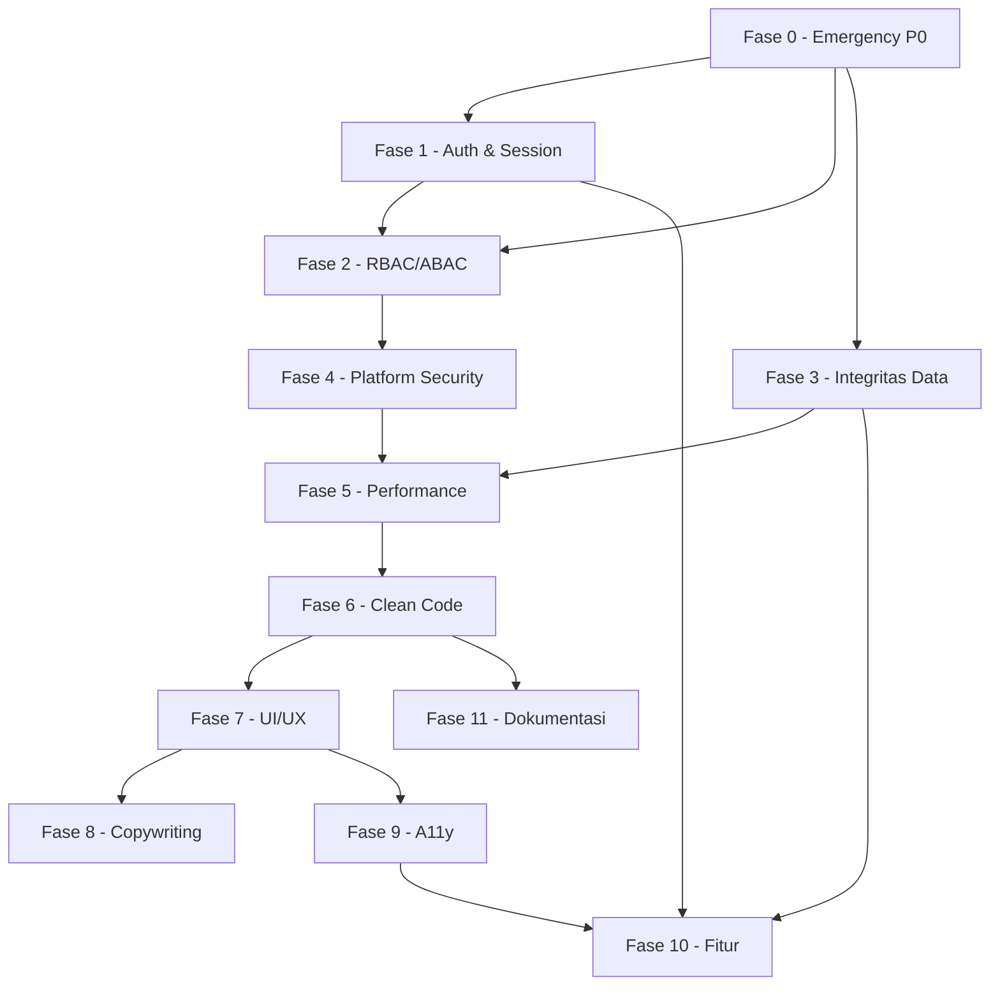

# Tasklist Remediasi — PortDash Regional 4

> **Sumber:** hasil audit kode `dashboardR4` tanggal 2026-11-11 (review fitur, tech, vulnerability, JWT auth, RBAC, performance, clean code, arsitektur, UI/UX anti-slop, copywriting, impeccable).
> **Sifat dokumen:** daftar kerja yang dapat dieksekusi dan dicentang. Berbeda dari `TASKLIST.md` dan `CHECKLIST.md` yang memuat klaim “selesai” yang tidak sesuai kode aktual (lihat `DOC-02`).
> **Cara pakai:** centang item hanya setelah *acceptance criteria* terpenuhi dan diverifikasi di environment bersih.

---

## 0. Skala Prioritas

| Prioritas | Definisi | Kapan harus selesai | Gerbang rilis |
|---|---|---|---|
| **P0 — Blocker** | Celah keamanan eksploitable, kebocoran data lintas cabang, atau angka palsu yang dipakai pengambilan keputusan | Segera, ≤ 3 hari kerja | **Tidak boleh deploy / tidak boleh diakses publik** |
| **P1 — High** | Wajib sebelum pilot produksi; menyangkut auth, integritas data, performa dasar, dan aksesibilitas inti | ≤ 2 minggu | Gerbang pilot |
| **P2 — Medium** | Wajib sebelum GA; utang teknis, konsistensi UI, copywriting, observability | ≤ 1 bulan | Gerbang GA |
| **P3 — Low** | Penyempurnaan, backlog, opsional | > 1 bulan | Backlog |

**Skala usaha (effort):**

| Kode | Estimasi |
|---|---|
| `S` | ≤ 2 jam |
| `M` | ≤ 1 hari |
| `L` | ≤ 3 hari |
| `XL` | > 3 hari |

**Skala dampak:** `Kritis` · `Tinggi` · `Sedang` · `Rendah`

**Legenda status:** `[ ]` belum · `[~]` sedang dikerjakan · `[x]` selesai & terverifikasi · `[!]` diblokir (tulis alasan)

---

## 1. Ringkasan Progres

| Prioritas | Jumlah item | Selesai | Sisa |
|---|---:|---:|---:|
| P0 | 14 | 14 | 0 |
| P1 | 43 | 40 | 3 |
| P2 | 53 | 33 | 20 |
| P3 | 12 | 5 | 7 |
| **Total** | **122** | **92** | **30** |

> Angka di tabel ini dihitung dari isi dokumen (`grep` atas `- [x]`/`- [ ]` per label prioritas), bukan diperbarui manual — pembaruan manual sebelumnya pernah membuat tabel dan isi berbeda.

> `[~]` menandai item yang sebagian selesai dengan sisa pekerjaan tertulis eksplisit: `DEP-06` (rotasi kredensial di server) dan `PERF-03` (endpoint agregasi sudah terbukti setara; migrasi Beranda ke endpoint itu dikerjakan sebagai `PERF-03b`).

| Fase | Fokus | Prioritas dominan | Jumlah |
|---|---|---|---:|
| Fase 0 | Emergency freeze | P0 | 12 |
| Fase 1 | Auth & session | P0–P2 | 12 |
| Fase 2 | RBAC/ABAC | P1–P2 | 10 |
| Fase 3 | Integritas data | P0–P2 | 9 |
| Fase 4 | Platform & dependency security | P1–P3 | 11 |
| Fase 5 | Performance | P1–P2 | 10 |
| Fase 6 | Clean code & arsitektur | P1–P3 | 14 |
| Fase 7 | UI/UX anti-slop | P2–P3 | 11 |
| Fase 8 | Copywriting | P2–P3 | 8 |
| Fase 9 | Impeccable / a11y | P1–P2 | 10 |
| Fase 10 | Fitur & roadmap | P1–P3 | 10 |
| Fase 11 | Dokumentasi & operasional | P1–P3 | 4 |

---

## 2. Urutan Eksekusi & Dependensi



**Aturan gerbang:**
1. Fase 0 **wajib 100%** sebelum aplikasi diakses dari jaringan publik/tunnel.
2. Fase 1 dan Fase 2 boleh paralel, tetapi `AUTH-01` harus mendahului `AUTH-02`.
3. Fase 3 boleh paralel dengan Fase 1–2 karena menyentuh lapisan berbeda.
4. Fase 6 (`CODE-08`, `CODE-09`) harus aktif sebelum Fase 10 dimulai agar setiap fitur baru punya test + CI.

---

## Fase 0 — Emergency Freeze (P0, ≤ 3 hari) — **SELESAI**

> **Gate:** setelah fase ini, semua item `P0` lulus uji regresi yang diperluas (lihat §14).

### Keamanan kredensial & sesi

- [x] **SEC-01 · Hapus seluruh kredensial default** `P0` `S` `Kritis`
  - File: `src/lib/seed.ts`, `src/lib/userPicSync.ts` (`INITIAL_OFFICIAL_PICS`), `src/lib/db.ts` (`initSchema`).
  - Langkah: hapus literal `password123`; ganti dengan password acak dari env `BOOTSTRAP_ADMIN_PASSWORD` (wajib di-set sekali) atau buat CLI `scripts/bootstrap-admin.mjs`; migrasi `NULL` password **tidak boleh** diisi `password123`.
  - Acceptance: `grep -rn "password123" src/ scripts/` → 0 hasil; login dengan akun lama gagal; audit log mencatat bootstrap admin.
- [x] **SEC-02 · Hapus panel demo & kredensial plaintext dari UI** `P0` `S` `Kritis`
  - File: `src/components/auth/LoginScreen.tsx`, `src/components/auth/AuthModal.tsx`.
  - Langkah: hapus blok “Akses Evaluasi Role & Cabang (Mode Demo)”, tombol quick-login, label “Sesi JWT Aktif”; hapus semua `submitLogin('100xx','password123')`; hapus opsi daftar publik jika `ALLOW_PUBLIC_REGISTRATION=false`.
  - Acceptance: build produksi tidak memuat string NIPP demo maupun kata sandi; screenshot login bersih.
- [x] **SEC-03 · Tolak refresh token pada jalur access token** `P0` `S` `Kritis`
  - File: `src/lib/auth.ts` (`getSessionFromRequest`).
  - Langkah: pada cabang `Authorization: Bearer`, wajib `payload.type === 'access'`; verifikasi terpisah untuk refresh; tolak `alg` selain `HS256` dan `type` tak dikenal.
  - Acceptance: test “login → pakai cookie refresh sebagai Bearer → `/api/master`” menghasilkan **401** (saat ini 200).
- [x] **SEC-04 · Pencabutan sesi nyata saat logout** `P0` `L` `Kritis`
  - File: `src/lib/auth.ts`, `src/app/api/users/logout/route.ts`, tabel baru `auth_sessions`.
  - Langkah: simpan `jti`, `user_id`, `token_version`, `expires_at`, `revoked_at`, `ip`, `user_agent`; logout menandai revoked; `verifyJwtToken`/`requireAuth` menolak `jti` yang dicabut.
  - Acceptance: setelah logout, access **dan** refresh token lama → 401 pada semua endpoint terlindungi.
- [x] **SEC-05 · Validasi user aktif & role terkini di setiap request** `P0` `M` `Kritis`
  - File: `src/lib/rbac.ts` (`requireAuth`, `resolveRequestSession`).
  - Langkah: tambahkan klaim `token_version`; bandingkan dengan `users.token_version`; tolak jika `active = 0` atau versi berbeda; naikkan versi saat role/scope/password berubah.
  - Acceptance: nonaktifkan user → request berikutnya 401 ≤ 1 request; ubah role → permission lama langsung hilang.

### Kebocoran data lintas cabang

- [x] **RBAC-01 · Terapkan scope cabang/departemen/verifikasi di `/api/keuangan/konsolidasi`** `P0` `M` `Kritis`
  - File: `src/app/api/keuangan/konsolidasi/route.ts`.
  - Langkah: gunakan `enforceBranchFilterForRead`, `enforceDepartmentFilterForRead`, `enforceVerificationFilterForRead`; filter wajib di SQL, bukan hanya parameter query.
  - Acceptance: PIC `R01` dengan `branches=ALL` hanya menerima baris `R01`; viewer hanya `verified`.
- [x] **RBAC-02 · Perketat `POST /api/verification`** `P0` `M` `Kritis`
  - File: `src/app/api/verification/route.ts`, `src/lib/db.ts` (`getMonthlyRecordsByIds`, `updateRecordVerification`).
  - Langkah: validasi setiap `recordIds` berada dalam scope session dan berstatus `pending_verification`/`revision_needed`; tolak ID di luar scope (403) dan ID tak dikenal (404); pertahankan four-eyes.
  - Acceptance: admin tidak bisa memverifikasi record cabang lain di luar scope-nya; ID campuran ditolak seluruhnya (atomik).
- [x] **RBAC-03 · Cegah eskalasi privilege via `POST /api/users/sync-drive`** `P0` `S` `Kritis`
  - File: `src/app/api/users/sync-drive/route.ts`, `src/lib/userPicSync.ts` (`importUsersFromSpreadsheet`).
  - Langkah: whitelist role yang boleh diimpor (`viewer`, `pic_cabang`, `pic_dept_regional`, `admin_regional`); hanya `super_admin` boleh membuat `super_admin`; validasi role/branch/dept lewat `resolveServerAssignedUserScope`; jangan membuat user dengan password default.
  - Acceptance: spreadsheet berisi `super_admin` → ditolak/diturunkan untuk admin_regional; password baru wajib di-set/reset.
- [x] **RBAC-04 · Kunci perpindahan path database di `POST /api/system-params`** `P0` `S` `Tinggi`
  - File: `src/app/api/system-params/route.ts`, `src/lib/db.ts` (`saveDbConfig`).
  - Langkah: hanya `super_admin`; tolak path baru jika DB tujuan belum ada atau kosong (mencegah bootstrap ulang akun default); audit perubahan; konfirmasi eksplisit.
  - Acceptance: admin_regional → 403; path ke DB kosong → 400 dengan pesan jelas.

### Integritas angka

- [x] **DATA-01 · Hapus angka fallback fiktif di dashboard** `P0` `M` `Kritis`
  - File: `src/components/portsight/ExecutiveKonsolidasiDashboard.tsx` (`?? 99.01`), `src/components/portsight/PortSightKeuangan.tsx` (`101.8`, `107.6`, `monthlyTrend` hardcode), `src/app/api/keuangan/konsolidasi/route.ts` (default `99.01`).
  - Langkah: ganti dengan state eksplisit `null`/`'—'` + label “Belum tersedia”; hapus array tren sintetis; sertakan periode & status verifikasi.
  - Acceptance: `grep -rn "99\.01\|101\.8\|107\.6" src/` → 0; dashboard tanpa data menampilkan empty state, bukan angka valid-looking.
- [x] **DATA-02 · Hapus default `99.01` pada API konsolidasi** `P0` `S` `Tinggi`
  - File: `src/app/api/keuangan/konsolidasi/route.ts`.
  - Langkah: `kpiMap[...]` tanpa nilai → `null`; jangan menormalkan `yoy/rka` ke angka tetap.
  - Acceptance: response tanpa data mengembalikan `null` dan UI menanganinya.
- [x] **DATA-03 · Hentikan tren bulanan hardcode** `P0` `S` `Tinggi`
  - File: `src/components/portsight/PortSightKeuangan.tsx`.
  - Langkah: ambil tren dari data server atau hapus chart bila belum tersedia.
  - Acceptance: chart kosong menampilkan pesan, bukan kurva rekaan.

### Operasional

- [x] **OPS-01 · Pastikan konfigurasi produksi aman** `P0` `S` `Kritis`
  - File: `.env.example`, `next.config.ts`, `README.md`.
  - Langkah: `ALLOW_PUBLIC_REGISTRATION=false`; `NEXT_PUBLIC_ENABLE_DEMO_LOGIN=false`; `JWT_SECRET` ≥ 32 byte acak; `NODE_ENV=production`; hapus origin tunnel statis dari `allowedDevOrigins` untuk build produksi.
  - Acceptance: checklist env terverifikasi; endpoint publik hanya login/logout/me/health.

---

## Fase 1 — Auth & Session Hardening

- [x] **AUTH-01 · Session store server-side** `P0` `L` `Kritis`
  - File baru: `src/lib/sessionStore.ts`; tabel `auth_sessions`.
  - Acceptance: setiap token dapat dicabut; query `SELECT ... WHERE jti=? AND revoked_at IS NULL` di jalur verifikasi.
- [x] **AUTH-02 · Rotasi refresh token + deteksi reuse** `P1` `M` `Tinggi`
  - Acceptance: refresh kedua dengan token lama → seluruh family dicabut + audit `TOKEN_REUSE`.
- [x] **AUTH-03 · Selaraskan TTL dengan kebijakan sesi** `P1` `M` `Tinggi`
  - Implementasi: access token **15 menit** (`ACCESS_TOKEN_TTL_MINUTES`), tidak pernah melebihi idle window yang dikonfigurasi; refresh 7 hari; `exp` JWT dihitung dari TTL yang sama dengan `maxAge` cookie.
  - **Idle timeout ditegakkan di server**: `resolveSessionToken` membandingkan `auth_sessions.last_seen_at` dengan `session_timeout_minutes` dan mencabut sesi (`revoked_reason = idle_timeout`) bila terlampaui — bukan hanya mengandalkan timer di klien.
  - Bukti: TTL terbaca 15,0 menit pada payload token; menyetel `last_seen_at` ke 3 jam lalu → request berikutnya `401` dan baris sesi tercatat `revoked_at` + `idle_timeout`.
  - Penopang: `GET /api/users/me?rotate=1` memperbarui access token tanpa merotasi refresh token (dipanggil klien setiap 10 menit saat pengguna aktif).
- [x] **AUTH-04 · Cabut sesi saat ubah password/role/scope/nonaktif** `P1` `M` `Tinggi`
  - Acceptance: aksi admin memicu `token_version++` dan revoke semua sesi user terkait + audit.
- [x] **AUTH-05 · Samakan respons & waktu login** `P1` `S` `Tinggi`
  - File: `src/app/api/users/login/route.ts`, `src/lib/db.ts` (`authenticateUser`).
  - Langkah: jalankan dummy scrypt untuk NIPP tidak dikenal; pesan sama untuk “tidak ada”, “salah”, “nonaktif” (kecuali kebijakan UX menyatakan lain); status sama (401).
- [x] **AUTH-06 · Rate limit per akun + per IP + backoff** `P1` `M` `Tinggi`
  - Acceptance: 20 percobaan tersebar ke banyak NIPP dari satu IP tetap terkena limit global; limiter tidak bisa di-bypass header.
- [x] **AUTH-07 · Proteksi CSRF eksplisit** `P1` `M` `Tinggi`
  - Langkah: validasi `Origin`/`Referer` untuk semua mutasi, atau double-submit token; `SameSite=Strict` untuk refresh.
- [x] **AUTH-08 · Perkuat atribut cookie** `P2` `S` `Sedang`
  - Implementasi: di produksi nama cookie menjadi `__Host-portsight_access_token` / `__Host-portsight_refresh_token` dengan `Secure`, `Path=/`, tanpa `Domain`. Nama lama tetap **dibaca** (`readAccessTokenCookie`/`readRefreshTokenCookie`) dan dihapus saat penerbitan cookie baru, sehingga upgrade tidak memaksa semua pengguna login ulang.
  - `clearSessionCookies` membersihkan kedua varian nama agar logout benar-benar terminal.
  - Bukti: pengujian regresi `Refresh token tidak diterima sebagai Bearer access token` dan `Logout mencabut access dan refresh token` tetap lulus.
- [x] **AUTH-09 · Alur reset & ubah password** `P1` `M` `Tinggi`
  - Implementasi: ubah mandiri (`currentPassword` + kebijakan 12 karakter) dan reset administratif lewat satu endpoint `POST /api/users/password`; tidak ada token reset via email (aplikasi tanpa email transaksional), sehingga reset dilakukan admin melalui UI terautentikasi.
  - Bukti: kata sandi salah → 401, kata sandi lemah → 400, konfirmasi tidak cocok → 400, ubah valid → 200 + token lama 401 + token baru 200, login kata sandi lama → 401. Semua sesi akun tercabut (`auth_sessions.revoked_at`) dan `token_version` naik. Audit tercatat untuk jalur sukses maupun gagal.
  - Acceptance: hash scrypt di DB, audit, invalidasi sesi, `must_change_password` dipaksa saat login berikutnya — terpenuhi.
- [ ] **AUTH-10 · MFA untuk `super_admin` dan `admin_regional`** `P2` `L` `Tinggi`
  - Acceptance: TOTP enroll/verify, recovery codes, enforcement per role.
- [ ] **AUTH-11 · Evaluasi SSO/OIDC korporat** `P3` `L` `Sedang`
  - Acceptance: ADR keputusan (adopsi/tunda) + pemetaan klaim → role.
- [x] **AUTH-12 · Logging aman** `P1` `S` `Tinggi`
  - Implementasi: `src/lib/logger.ts` — `redactForLog()` mengganti nilai dengan kunci sensitif (`password`, `secret`, `token`, `api_key`, `authorization`, `cookie`, `jti`, `credential`) menjadi `[redacted]`, memotong string > 500 karakter, membatasi kedalaman 4 dan 40 kunci.
  - `getRequestId()` menerima `x-request-id` dari hulu hanya bila cocok pola `[A-Za-z0-9._:-]{8,128}` (mencegah log injection), jika tidak membuat UUID.
  - Proxy menyetel header `x-request-id` pada **semua** respons (401/403/CSRF/404) dan meneruskannya ke handler; `logError()` dipakai di `/api/modules-data`, `/api/manual-input`, `/api/keuangan/konsolidasi`.
  - Bukti: pengujian regresi `Setiap respons API menyertakan x-request-id` lulus; pencarian `console.*` untuk kata kunci sensitif di `src/app/api/**` → 0 hasil.

---

## Fase 2 — RBAC & ABAC

- [x] **RBAC-05 · Satu lapisan policy terpusat** `P1` `L` `Tinggi`
  - Implementasi: `src/lib/policy.ts` — `authorize(actor, action, context)` mengembalikan `{ allowed, code, reason }` dengan `code` yang dapat diuji (`super_admin_only`, `cannot_target_self`, `branch_out_of_scope`, `viewer_read_only`, …) dan `reason` berbahasa Indonesia siap dikirim sebagai badan galat API.
  - **5 cek role ad-hoc dihapus** dan dialihkan ke policy:
    | Lokasi lama | Aturan |
    |---|---|
    | `POST /api/users` | hanya Super Admin yang boleh membuat akun Super Admin |
    | `PUT /api/users` | promosi ke Super Admin + proteksi akun Super Admin |
    | `DELETE /api/users` | proteksi akun Super Admin |
    | `POST /api/users/password` | proteksi akun Super Admin + larangan reset akun sendiri |
    | `POST /api/system-params` | perubahan lokasi basis data hanya Super Admin |
  - Scope baca juga dipusatkan: `resolveReadBranchScope()` menggantikan tiga salinan cek `pic_cabang` di `modules-data` dan `manual-input`.
  - Bukti: **45 unit test** `tests/unit/policy.test.ts` (matriks 14 action × 5 role, proteksi akun, eskalasi privilege, scope cabang/departemen) + **4 uji regresi API baru** yang membuktikan `admin_regional` ditolak `403 code=super_admin_only` saat mengubah/menghapus/mereset akun Super Admin.
  - Catatan: `grep -rn "role === 'super_admin'" src/app/api/` → **0 hasil**.
  - Acceptance “tidak ada pengecekan role ad-hoc di route/komponen” — untuk API terpenuhi. Komponen UI masih melakukan pengecekan role untuk menyembunyikan menu (bukan wewenang, hanya kosmetik); dijangkau oleh `A11Y`/`CODE-06`.
- [x] **RBAC-06 · Scope departemen untuk `pic_dept_regional` di `modules-data`** `P1` `S` `Tinggi`
  - Acceptance: user `dept_keu` tidak menerima baris dept lain.
- [x] **RBAC-07 · Kontrak filter cabang tunggal (kode kanonik)** `P1` `M` `Tinggi`
  - File: `src/app/api/keuangan/konsolidasi/route.ts`, `src/lib/constants.ts`.
  - Langkah: terima `branch` (kode), resolve ke `branch_id`/`branch_name` di server; hapus `branch_name IN (?)` mentah.
  - Acceptance: `branches=R01` mengembalikan data `R01`; nama cabang tidak lagi menjadi kontrak API.
- [x] **RBAC-08 · Hilangkan duplikasi cek di proxy vs handler** `P2` `M` `Sedang`
  - Pembagian tugas kini jelas dan terdokumentasi:
    - **Proxy** = pre-filter berbasis permission kasar (`records:read`, `users:manage`, …) + default-deny untuk route tak terdaftar. Tidak mengambil keputusan berbasis resource.
    - **Handler** = keputusan resource-level melalui `authorize()` (akun target, cabang target, departemen target).
  - Efek: `POST /api/system-params` dulu menolak `admin_regional` di dua tempat dengan pesan berbeda; sekarang proxy menolak karena `system_params:manage` tidak dimiliki role tersebut, dan bila izin itu kelak diberikan, handler tetap menolak lewat `config:update_database`. Diuji: `admin_regional → 403`.
- [x] **RBAC-09 · Scope di level SQL** `P1` `L` `Tinggi`
  - Semua filter cabang/periode/waktu sudah dipindah ke SQL (lihat `PERF-01`, `PERF-08`). Audit menemukan **dua penyimpangan terakhir** dan keduanya diperbaiki:
    1. `availableBranches` pada `/api/keuangan/konsolidasi` membaca `SELECT DISTINCT` seluruh tabel lalu menyaring di JavaScript. Sekarang `WHERE branch_code IN (…)` ditambahkan ke SQL.
    2. Index `idx_mod_fin_ent_filter` menempatkan `branch_code` di kolom **terakhir**, sehingga query ber-scope tetap `SCAN`. Ditambahkan `idx_mod_fin_ent_branch_name (branch_code, branch_name)`.
  - Bukti `EXPLAIN QUERY PLAN`: sebelum `SCAN … USE TEMP B-TREE FOR DISTINCT`; sesudah **`SEARCH … USING COVERING INDEX idx_mod_fin_ent_branch_name (branch_code=?)`** tanpa temp B-tree.
  - Hasil identik: filter SQL `["R01"]` = filter JS lama `["R01"]`.
  - **Temuan tambahan:** tabel `module_finansial_entitas` ternyata **hanya** dibuat oleh skrip Python (`scripts/ingest_*.py`), bukan oleh skema aplikasi — instalasi baru yang belum menjalankan ingest akan gagal di `/api/keuangan/konsolidasi`. Tabel + indeksnya kini dibuat idempoten di `initSchema()`.
- [x] **RBAC-10 · Test matrix role × endpoint × resource** `P1` `M` `Tinggi`
  - Acceptance: minimal 5 role × 20 endpoint matrix otomatis; semua lulus.
- [x] **RBAC-11 · Default deny untuk route tak terdaftar** `P2` `S` `Sedang`
  - Acceptance: endpoint baru tanpa policy → 403 di test.
- [x] **RBAC-12 · Viewer enforcement di semua endpoint data** `P1` `S` `Tinggi`
  - Acceptance: `verifiedOnly` dipaksa di konsolidasi, export, dan endpoint baru.
- [x] **RBAC-13 · Scope write pada `importService`/`commit`** `P1` `M` `Kritis`
  - Acceptance: commit dengan `branch_id` di luar scope → 403 seluruh batch; tidak ada partial write.
- [x] **RBAC-14 · Four-eyes diperluas ke impor & manual input** `P2` `M` `Tinggi`
  - Acceptance: verifikator ≠ uploader ≠ approver pada rantai penuh.
  - **Celah yang ditemukan**: pengecekan hanya membaca `monthly_records.uploaded_by`, padahal angka yang sama juga ditulis ke enam tabel `module_*` yang masing-masing menyimpan `uploaded_by` sendiri. Pengguna input manual yang menjadi pengunggah baris modul dapat menyetujuinya selama record induk menyebut orang lain.
  - **Celah kedua**: identitas dibandingkan dengan mencampur NIPP dan nama tampilan tanpa urutan yang jelas, sehingga mengganti nama akun mengubah hasilnya.
  - Implementasi: `src/lib/fourEyes.ts` — `findUploaderConflict` (NIPP → session id → nama, dan melaporkan **yang mana** yang cocok), `checkSeparationOfDuties`, `fourEyesMessage` (menyebut id rekaman + langkah berikutnya). Route verifikasi kini mengumpulkan pengunggah dari record induk **dan** tabel modul lewat `getModuleUploadersByRecordIds()`.
  - **Bukti**: `tests/unit/fourEyes.test.ts` (13 uji) + uji regresi `Verifikator tidak dapat menyetujui data yang ia unggah sendiri` yang **benar-benar mengunggah lalu menyetujui**: hasilnya `403` dengan `code: four_eyes_violation`, dan status baris tetap `pending_verification` (penolakan tidak boleh sudah menulis persetujuan).

---

## Fase 3 — Integritas Data & Sumber Kebenaran

- [x] **DATA-04 · Model status data eksplisit** `P1` `M` `Tinggi`
  - Langkah: bedakan `no_data`, `not_verified`, `pending`, `revision`, `verified`, `simulated`, `failed`; jangan pakai `0` sebagai “tidak ada”.
  - Implementasi: `src/lib/dataStatus.ts` — tujuh status + `resolveDataStatus()` (dari jumlah baris dan status verifikasinya), `mergeDataStatuses()` untuk menggabungkan beberapa modul, `describeDataStatus()` (label Indonesia, tone, `isFinal`, `hasValue`), dan `formatReportedValue()` yang mengembalikan label alih-alih `0`.
  - `/api/dashboard/summary` kini mengembalikan `dataStatus` per cabang, dihitung dari baris yang benar-benar ada. Kueri statusnya **sengaja tidak** difilter `verifiedOnly`: eksekutif perlu tahu bahwa sebuah cabang hanya punya data pending, yang tidak terlihat bila barisnya disaring lebih dulu.
  - Aturan yang diuji: baris `revision_needed` mengalahkan `verified` (satu baris ditolak membuat totalnya tidak layak dipercaya); `failed` mengalahkan semuanya; "0 TEUs terverifikasi" tetap `verified`, sedangkan "belum pernah lapor" adalah `no_data`.
  - **Bukti**: 17 unit test + verifikasi runtime — menandai satu baris R03 sebagai `revision_needed` membuat endpoint melaporkan `dataStatus: "revision"` untuk R03 (dipulihkan setelah uji).
- [x] **DATA-05 · Data lineage & snapshot** `P1` `L` `Tinggi`
  - Acceptance: setiap baris menyimpan file asal, sheet, baris, waktu impor, uploader, batch id; snapshot terverifikasi dapat dipulihkan dan diaudit.
  - Migrasi #7 menambahkan `source_file`, `source_sheet`, `source_row`, `batch_id` pada keenam tabel `module_*` (nullable — baris lama memang tidak punya asal yang tercatat, dan mengarangnya akan mengalahkan tujuan kolom ini).
  - `src/lib/lineage.ts`: `buildLineage` / `describeLineage` (mis. "dari laporan.xlsx, sheet LAPKEU, baris 12 · diunggah 10004 · batch batch_abc"), `hasRestorableSnapshot`, dan `restoreVerifiedSnapshot`.
  - Jalur tulis manual kini mencatat lineage **di dalam transaksi yang sama** dengan barisnya, dan menyebutkannya pada audit log.
  - **Celah yang ditemukan**: `verified_snapshot_json` hanya ditulis, tidak pernah bisa dibaca kembali. Snapshot yang tidak dapat dipulihkan hanya mencatat apa yang dulu disetujui tanpa bisa mengembalikannya, sehingga salah timpa angka resmi tidak dapat diperbaiki. Ditambahkan `POST /api/verification/restore` (`verification:approve`, dibatasi cakupan cabang, tercatat sebagai audit `RESTORE_SNAPSHOT`).
  - Nama tabel divalidasi sebagai enum Zod, bukan string bebas: nama tabel diinterpolasi ke SQL, dan itu bukan hal yang layak diserahkan pada harapan.
  - **Bukti**: 14 unit test round-trip (nilai hasil edit kembali ke nilai yang dulu disetujui, `verified_by` terisi, snapshot dikosongkan agar tidak dipakai dua kali, snapshot rusak ditolak, kolom yang sudah dihapus diabaikan) + uji regresi yang membuktikan baris tak dikenal → `404` dan nama tabel di luar whitelist → `400`.
- [ ] **DATA-06 · Versioning target/RKAP** `P2` `L` `Sedang`
  - Acceptance: perubahan target tercatat dengan versi, berlaku-mulai, dan pelaku.
- [x] **DATA-07 · Hapus periode hardcode** `P1` `M` `Tinggi`
  - File: `src/app/page.tsx` (`handleExportExcel`), `src/app/page.tsx` (`/api/verification?month=9&year=2026`), `src/app/api/modules-data/route.ts` (preset periode).
  - Acceptance: export & pending count mengikuti filter aktif; tidak ada tahun/bulan literal.
- [x] **DATA-08 · Idempotensi impor** `P1` `M` `Tinggi`
  - Acceptance: impor file sama dua kali tidak menggandakan baris; hasil kedua “0 baru, N diperbarui”.
  - Akar masalah: id baris impor memuat `Date.now()` dan indeks baris (`rec_imp_${year}_${month}_${code}_${indicator}_${Date.now()}_${index}`), sehingga setiap unggahan membuat identitas baru dan duplikat tidak terhindarkan.
  - Perbaikan: `src/lib/recordKey.ts` menurunkan id dari kunci alami `(tahun, bulan, cabang, indikator)` → `rec_imp_2026_09_r01_fin-01`. `importService` membandingkan nilai (toleransi `1e-9`) terhadap baris yang sudah ada dan **membuang baris yang tidak berubah dari himpunan tulis**, sehingga status verifikasi tidak ter-reset oleh unggahan ulang yang identik.
  - Hasil respons kini membedakan `createdCount` / `updatedCount` / `unchangedCount` / `revertedVerifiedCount`, dan `valid_rows` melaporkan jumlah yang benar-benar ditulis — bukan jumlah yang dikirim.
  - **Bukti uji regresi** (`scripts/regression-test.mjs`, uji `Import idempoten`):
    1. impor pertama → `baru: 1`
    2. impor ulang file identik → `tetap: 1`, `tersimpan: 0`, jumlah baris untuk kunci itu tetap `1`
    3. nilai diubah → `diperbarui: 1`
    4. baris berstatus `verified` tetap `verified` setelah impor ulang identik
  - Unit test: `tests/unit/recordKey.test.ts` (22 uji).
- [ ] **DATA-09 · Presisi numerik** `P2` `L` `Sedang`
  - Langkah: simpan rupiah sebagai integer/decimal, persentase sebagai decimal; hindari `REAL` untuk uang.
- [x] **DATA-10 · Integritas referensial tabel `module_*`** `P2` `M` `Sedang`
  - Acceptance: FK/validasi `branch_code` & `month/year`; tidak ada baris yatim.
  - Implementasi: `src/lib/dataIntegrity.ts` — `validateModuleScope` (kode cabang wajib **kanonis**, bulan 1–12, tahun 2000–2100), `assertModuleScope` (melempar `ModuleScopeError` → route mengembalikan `400` dengan daftar masalah, bukan `500`), dan `auditModuleTables` (melaporkan baris yatim, periode tidak valid, dan tautan record menggantung).
  - **Bug yang ditemukan saat audit**: jalur input manual mengisi `'R01'` ketika payload tidak memuat cabang, sehingga data diatribusikan ke Makassar tanpa memberi tahu siapa pun. Default senyap itu dihapus; cabang kosong kini ditolak.
  - **Temuan kedua, lebih besar**: **886 baris** modul menunjuk `monthly_record_id` yang tidak ada. Skrip ingest menulis `rec_fin_2025_9_r01_beban` sementara `monthly_records` memakai skema id yang berbeda (`rec_2026_1_term_ambon_cargo`), jadi tautan itu tidak pernah tersambung — dan `updateRecordVerification` yang meng-cascade lewat `monthly_record_id` tidak pernah mencocokkan apa pun. Migrasi #6 membersihkan tautan yang menggantung itu; 878 tautan yang valid dibiarkan.
  - **Bukti**: 18 unit test (termasuk audit terhadap **basis data nyata**, yang gagal bila ada baris yatim) + migrasi #6 dan #7 tercatat pada `data/ed_dashboard.db` (1–7), `dangling = 0`.
- [x] **DATA-11 · Validasi tulis dengan Zod di semua modul** `P1` `M` `Tinggi`
  - Audit: dari semua jalur tulis, hanya `POST /api/users/sync-drive` yang membaca body tanpa skema (`(await req.json()) as { action?, direction? }`), lalu membandingkan string longgar dengan enam sinonim.
  - Diperbaiki: `userSyncDriveSchema` (enum eksplisit + `transform` ke default `push`). Nilai tak dikenal kini ditolak `400`, bukan diam-diam menjadi `push`.
  - Hasil audit: **semua** handler tulis (`users`, `users/password`, `manual-input`, `import/commit`, `import/validate`, `import/sheets-sync`, `import/drive-sync`, `verification`, `templates`, `system-params`) memakai `parseWithSchema` sebelum menyentuh basis data.

---

## Fase 4 — Platform, Dependency & Hardening

- [x] **DEP-01 · Ganti `xlsx@0.18.5`** `P1` `M` `Tinggi`
  - Implementasi: `xlsx@0.20.3` dipasang dari tarball resmi `https://cdn.sheetjs.com/xlsx-0.20.3/xlsx-0.20.3.tgz` (versi registry npm berhenti di 0.18.5 dan tidak akan pernah dipatch).
  - Pengerasan tambahan: seluruh pembacaan workbook lewat `src/lib/spreadsheet.ts` (`readWorkbookSafe` + `sheetToRowsChecked`) dengan `sheetRows` terbatas, `cellFormula:false`, `cellHTML:false`, `bookVBA:false`, `bookFiles:false`.
  - Bukti: `npm audit --omit=dev` → **0 vulnerabilities**; unggahan rusak → 400 dengan pesan jelas, ekstensi `.exe` → 400, berkas 6 MB → 413, workbook >2.000 baris → 413 (tidak lagi dipotong diam-diam), workbook tepat 2.000 baris → 200.
  - Bukti: `npm audit` → *Prototype Pollution* + *ReDoS*, **no fix available**.
  - Langkah: gunakan SheetJS ≥ 0.20.3 dari sumber resmi, atau `exceljs`; batasi `sheetRows`, ukuran, dan kedalaman.
  - Acceptance: `npm audit --omit=dev` bersih; file berbahaya tidak memblokir event loop.
- [x] **DEP-02 · Hapus dependensi mati** `P3` `S` `Rendah`
  - `jspdf`, `jspdf-autotable` tidak diimpor di `src/`.
- [x] **DEP-03 · Putuskan runtime DB** `P1` `L` `Tinggi`
  - Keputusan: **tetap `node:sqlite` untuk pilot** (satu instance), PostgreSQL menjadi target wajib saat pemicu scale-out/PITR terpenuhi. Keputusan, syarat, pemicu migrasi, alternatif yang ditolak, dan rencana migrasi ada di [`docs/architecture/ADR-0001-database-runtime.md`](docs/architecture/ADR-0001-database-runtime.md).
  - `engines.node` sudah `>=22.5.0` dan CI memakai Node 22 (README tidak lagi menyebut Node 18/20).
- [x] **DEP-04 · Dependabot + audit di CI** `P1` `S` `Tinggi`
- [x] **DEP-05 · `npm ci` + lockfile integrity** `P1` `S` `Tinggi`
- [~] **DEP-06 · Secret scanning & bersihkan git history** `P1` `M` `Kritis`
  - Selesai: `.gitleaks.toml` + job `secret-scan` di CI (riwayat penuh, `fetch-depth: 0`); pemindaian riwayat 67 commit didokumentasikan di [`docs/operations/SECRET-SCAN-2026-11-11.md`](docs/operations/SECRET-SCAN-2026-11-11.md).
  - Temuan: kata sandi demo `password123` (sudah tidak berlaku karena migrasi reset akun) dan `JWT_SECRET` placeholder pada `.env.example` (perlu rotasi bila pernah dipakai di server). Tidak ada token Cloudflare/API key/DB password di riwayat.
  - **Sisa:** rotasi `JWT_SECRET` + `SECRETS_ENCRYPTION_KEY` + token tunnel di server (tindakan manual ICT Ops) dan keputusan apakah riwayat git ditulis ulang.
- [x] **DEP-07 · Rate limiter kompatibel multi-instance** `P2` `M` `Sedang`
  - Implementasi: rate limiter sudah memakai tabel SQLite `auth_rate_limits` (bukan memori proses), sehingga dua proses yang berbagi satu berkas basis data WAL melihat hitungan yang sama. Ditambahkan dua lapisan yang sebelumnya hilang:
    1. `purgeStaleAuthData()` menghapus sesi kedaluwarsa/dicabut-lama dan entri rate limit basi; tanpa ini tabel tumbuh tanpa batas dan lookup melambat.
    2. `maybeRunAuthHousekeeping()` membatasi pembersihan maksimum sekali per jam per proses, dijalankan di latar belakang pada login sukses, dan tidak pernah menggagalkan autentikasi.
  - **Batas yang jujur:** store bersama ini hanya benar bila semua instance menunjuk ke **satu** berkas SQLite. Untuk instance terpisah/HA diperlukan PostgreSQL atau Redis — sudah dicatat sebagai pemicu migrasi di `ADR-0001`.
  - Bukti: 6 unit test `tests/unit/purgeStaleAuthData.test.ts` (hapus kedaluwarsa, pertahankan yang baru dicabut untuk deteksi reuse, hormati masa tenggang kustom, bersihkan rate limit basi, aman pada DB kosong).
- [x] **DEP-08 · Backup, restore, dan uji pemulihan** `P1` `M` `Tinggi`
  - Implementasi: `scripts/backup-db.mjs` + script npm `backup`, `backup:list`, `restore`. Memakai `VACUUM INTO` (bukan `cp`, yang dapat kehilangan isi WAL), menjalankan `PRAGMA integrity_check`, dan menulis manifest berisi ukuran + SHA-256. Restore memvalidasi snapshot lebih dulu lalu menyimpan basis data lama sebagai `*.pre-restore-*`.
  - Runbook lengkap (apa yang di-backup, jadwal retensi, prosedur insiden, batas yang diketahui): [`docs/operations/BACKUP-RESTORE.md`](docs/operations/BACKUP-RESTORE.md).
  - **Drill 2026-11-11:** 12 akun → dihapus menjadi 1 → restore → 12 akun; `integrity_check = ok`; snapshot 2.160 KB; waktu restore < 2 detik. Target RTO ≤ 30 menit, RPO ≤ 6 jam (terdokumentasi).
- [x] **DEP-09 · Enkripsi secret at-rest** `P1` `M` `Tinggi`
  - Implementasi: `src/lib/secrets.ts` (AES-256-GCM, `enc:v1:<iv>:<tag>:<ciphertext>`). Kunci dari `SECRETS_ENCRYPTION_KEY` (32 byte hex/base64) atau diturunkan dari `JWT_SECRET`; produksi menolak start tanpa kunci.
  - `pg_password` di `data/db_config.json` dan `google_api_key` + `api_gateway_token` di `integration_settings` kini ditulis sebagai ciphertext; pembaca (`getDbConfig`, `getIntegrationCredentials`) selalu mengembalikan plaintext ke pemanggil.
  - Migrasi satu kali `cfg_secrets_encryption` mengenkripsi nilai plaintext lama tanpa intervensi.
  - Bukti: menyimpan kredensial uji lewat API → isi DB mentah `enc:v1:+ssE78LJ...`, tidak mengandung plaintext; `db_config.json` juga `enc:v1:...`; respons API tetap `••••••••`; nilai dihapus bersih setelah uji.
- [x] **DEP-10 · Security headers + CSP** `P1` `M` `Tinggi`
  - Bukti: `curl -I` hanya `X-Powered-By: Next.js`.
  - Acceptance: HSTS, `X-Content-Type-Options`, `X-Frame-Options`/`frame-ancestors`, `Referrer-Policy`, `Permissions-Policy`, CSP ketat, `poweredByHeader: false`.
- [x] **DEP-11 · `getClientIp` hanya percaya proxy tepercaya** `P1` `S` `Tinggi`
  - Acceptance: spoof `X-Forwarded-For` tidak mengubah kunci rate limit saat di belakang Cloudflare (`cf-connecting-ip`).

---

## Fase 5 — Performance

- [x] **PERF-01 · Filter di SQL untuk `modules-data`** `P1` `M` `Tinggi`
  - Bukti: payload 525–614 KB, `SELECT *` enam tabel tanpa `WHERE`.
  - Acceptance: hanya periode/cabang diminta yang dibaca; ukuran response ≤ 150 KB untuk kasus umum.
- [x] **PERF-02 · Paginasi `records`, `audit`, `modules-data`** `P1` `M` `Tinggi`
  - Bukti: `/api/records` mengembalikan 655 KB.
  - Acceptance: `limit`/`cursor` wajib; default ≤ 200 baris.
- [~] **PERF-03 · Endpoint agregasi khusus Beranda** `P1` `L` `Tinggi`
  - Acceptance: Beranda tidak mengunduh data mentah; agregasi dihitung server-side.
  - Selesai: `GET /api/dashboard/summary` + `src/lib/dashboardSummary.ts`. Sembilan agregat per cabang (pendapatan, laba usaha, TEUs, ton, RKAP, YoY, RFU, BOR, `hasData`) dihitung dengan lima `GROUP BY` di SQLite; aturan proteksi cabang dan `verifiedOnly` memakai `resolveReadBranchScope()` / `resolveVerifiedOnly()` yang sama dengan endpoint lain.
  - **Bukti ukuran**: `?period=YTD Sep 2026` → **5,8 KB** menggantikan **523 KB** `/api/modules-data` (−99%).
  - **Bukti kesetaraan**: `scripts/verify-summary-equivalence.mjs` menghitung ulang 28 cabang dengan algoritma lama lalu membandingkan delapan angka per cabang. Awalnya **27 cabang berbeda**; dua bug ditemukan dan diperbaiki:
    1. Agregasi menjumlahkan seluruh bulan dalam rentang, padahal `/api/modules-data` hanya menyisakan baris terbaru per (cabang, kategori akun) — pendapatan jadi ~2× lipat. Diganti `ROW_NUMBER() OVER (PARTITION BY branch_code, kategori ORDER BY year DESC, month DESC)`.
    2. Predikat rentang memakai bentuk tiga-`OR` untuk semua jendela, sehingga `(year = 2026 AND month >= 1)` ikut mencocokkan Oktober & November pada "YTD Sep 2026". Diganti `year = ? AND month BETWEEN ? AND ?` untuk jendela satu tahun; tiga-`OR` hanya untuk jendela lintas tahun. Regresi dikunci `tests/unit/dashboardSummary.test.ts` (dijalankan terhadap SQLite in-memory).
  - Hasil akhir: `✓ Seluruh cabang identik dengan perhitungan lama.` (exit 0) untuk 28/28 cabang.
  - **Bug ikutan yang ditemukan**: `kpiRecords` dari `/api/modules-data` dikirim camelCase (`indicatorId`, `branchCode`, `verificationStatus`) tetapi bertipe `MonthlyRecord` (snake_case) di hook. Kode lolos type-check namun selalu `undefined`, sehingga fallback RFU/SLA tidak pernah aktif. Tipe `ModuleKpiRecord` ditambahkan dan hook diperbaiki.
  - Sisa pekerjaan → `PERF-03b`.
- [ ] **PERF-03b · Migrasi Beranda ke endpoint agregasi** `P1` `L` `Tinggi`
  - Acceptance: `useBerandaAnalytics` tidak lagi memanggil `/api/modules-data`; angka di Beranda tidak berubah.
  - Sisa konsumen data mentah yang perlu agregat server: KPI per layanan (KAPAL/GT, PETIKEMAS/TEUS, BARANG/TON, PENUMPANG/ORANG, RUPA), KPI finansial (pendapatan/beban/laba usaha), RFU & SLA, tabel `terminalsOverview`, seri bulanan untuk grafik, serta daftar alert peralatan & opkom.
  - Wajib: perluas `scripts/verify-summary-equivalence.mjs` agar setiap angka baru juga dibandingkan, bukan hanya delapan agregat per cabang.
- [ ] **PERF-04 · Client cache (React Query/SWR)** `P2` `M` `Sedang`
  - Acceptance: pindah tab tidak memicu fetch ulang identik; `staleTime` terdefinisi.
- [x] **PERF-05 · Dynamic import Beranda & chart** `P2` `S` `Sedang`
  - Implementasi: `PortSightBeranda` diubah dari import statis menjadi `dynamic()` di `src/app/page.tsx`, menyusul enam modul lain yang sudah dinamis. `ModuleSkeleton` dipakai sebagai placeholder sehingga tidak ada layout shift.
  - **Bukti A/B pada build produksi** (halaman login, semua `<script>` dihitung):
    - Beranda statis: **1.147 KB**, recharts **ikut** di muatan awal.
    - Beranda dinamis: **672 KB**, recharts **tidak ada** di muatan awal.
  - Selisih: **−475 KB (−41%)** sebelum pengguna login.
- [x] **PERF-06 · Hapus operasi sinkron berat dari request** `P1` `M` `Tinggi`
  - Implementasi: `hashPasswordAsync` / `verifyPasswordAsync` (promisified `crypto.scrypt`) plus `authenticateUserAsync`, `verifyUserPasswordAsync`, `setUserPasswordAsync`. Login dan endpoint kata sandi memakai varian async; varian sinkron dipertahankan hanya untuk seed/migrasi.
  - Efek: satu login tidak lagi memblokir event loop ± 100 ms; login paralel tidak saling mengantre.
  - Bukti: 3 login Admin Regional berturut-turut di log dev server ≈ 28–32 ms per permintaan.
- [ ] **PERF-07 · Kurangi bentuk payload** `P2` `S` `Sedang`
  - Acceptance: field selection / DTO, kompresi aktif.
- [x] **PERF-08 · Verifikasi index dengan `EXPLAIN QUERY PLAN`** `P2` `S` `Sedang`
  - Semua query utama diperiksa; **0 full scan**:

    | Query | Plan |
    |---|---|
    | `module_finansial` (cabang + periode) | `SEARCH ... USING INDEX idx_mod_fin_branch_period (branch_code=? AND year=? AND month>? AND month<?)` |
    | `module_opkom` (cabang + periode) | `SEARCH ... USING INDEX idx_mod_opkom_branch_period` |
    | `monthly_records` (cabang + periode) | `SEARCH ... USING INDEX idx_records_branch_period` |
    | `audit_logs` (terbaru) | `SCAN ... USING INDEX idx_audit_logs_timestamp` |
    | `auth_sessions` (lookup jti) | `SEARCH ... USING INDEX sqlite_autoindex` |
    | `auth_sessions` (purge) | `SEARCH ... USING INDEX idx_auth_sessions_expiry` |
    | `auth_rate_limits` (lookup) | `SEARCH ... USING INDEX sqlite_autoindex` |

  - **Bug ditemukan & diperbaiki:** `buildPeriodSql` memakai `(year * 100 + month) BETWEEN ? AND ?`. Membungkus kolom dalam ekspresi membuat index komposit hanya bisa menyaring `branch_code`, sehingga seluruh tahun cabang tersebut dibaca. Ditulis ulang menjadi `year = ? AND month BETWEEN ? AND ?` (satu tahun) atau tiga rentang OR (lintas tahun) — plan berubah dari `(branch_code=?)` menjadi `(branch_code=? AND year=? AND month>? AND month<?)`.
  - **Bukti ekuivalensi:** predikat lama dan baru dibandingkan pada grid 2023–2028 untuk 6 rentang (YTD, Q3, satu bulan, setahun penuh, dua rentang lintas tahun) → **0 ketidakcocokan**; dikunci sebagai unit test `tests/unit/periodSql.test.ts` (9 test).
- [x] **PERF-09 · Sinkronisasi spreadsheet sebagai job** `P2` `M` `Sedang`
  - Implementasi: `scheduleUsersSpreadsheetSync()` di `src/lib/db.ts` — export dijadwalkan pada tick berikutnya dengan jendela 250 ms yang digabungkan (coalesced) dan `unref()` agar proses tidak ditahan. `createUser`, `updateUser`, dan `deleteUser` tidak lagi memanggil `exportUsersToSpreadsheet` secara sinkron di jalur request.
  - Efek: sepuluh pembuatan akun berurutan menulis satu berkas, bukan sepuluh; respons HTTP tidak menunggu disk I/O.
  - Catatan: berkas spreadsheet adalah cermin kenyamanan, bukan sumber kebenaran — basis data tetap sumber utama.
- [ ] **PERF-10 · Budget performa + state loading/error** `P2` `S` `Sedang`
  - Acceptance: p95 API < 300 ms lokal, LCP < 2,5 s; setiap fetch punya loading/empty/error.

---

## Fase 6 — Clean Code & Arsitektur

- [x] **CODE-01 · ESLint warning → 0 (lalu jadikan error)** `P1` `S` `Tinggi`
  - Bukti: 98 warning (`no-unused-vars`, `exhaustive-deps`, `loading` tak terpakai).
- [x] **CODE-02 · Pecah `src/app/page.tsx`** `P2` `L` `Sedang`
  - Sebelum: **1.143 baris** dalam satu fungsi — restore sesi, timer idle, sinkron URL, fetch master data, switch 380 baris modul, lima modal, dan layout.
  - Sesudah: `page.tsx` **254 baris** (composition root saja). Tiga hook: `useDashboardSession` (sesi/tema/idle/rotasi token), `useDashboardFilters` (tab/cabang/periode + aturan deep link vs login baru), `useDashboardData` (master data + counter verifikasi + invalidasi lewat `reload`). Tiga komponen: `DashboardModuleView` (switch modul), `DashboardOverlays` (semua overlay), `GovernanceSubnav`. Registry `moduleRegistry.tsx` memuat seluruh split point `dynamic()`.
  - Dua daftar tab yang dirawat manual (`VALID_TABS` + daftar tab governance) digabung ke `src/lib/tabs.ts` — sebelumnya guard `?tab=` dan cek RBAC bisa menyimpang.
  - **Bukti**: `tests/unit/dashboardShell.test.ts` (6 tes) menahan regresi: shell tidak boleh `fetch`/`localStorage`/`abortController`, tidak boleh membandingkan id tab, wajib < 300 baris; setiap potongan < 320 baris; `next/dynamic` tidak boleh kembali ke shell.
  - Angka Beranda tidak berubah (`verify-summary-equivalence.mjs` 28/28 cabang).
- [x] **CODE-03 · Pecah `src/lib/db.ts`** `P2` `L` `Sedang`
  - Sebelum: **1.988 baris** (skema, koneksi, dan seluruh query jadi satu).
  - Sesudah: `db.ts` **95 baris** (barrel). Lapisan dasar: `db/helpers.ts` (47), `db/schema.ts` (586), `db/connection.ts` (179), `db/maintenance.ts` (77). Repository per domain: `master` (114), `users` (238), `records` (284), `audit` (70), `settings` (190), `authSessions` (248).
  - `dbQueries` tetap satu objek datar (spread dari repository) supaya 28 pemakai `@/lib/db` tidak berubah; kontrak publik (8 simbol) utuh.
  - `initSchema` menghapus baris `auth_sessions` lewat SQL langsung saat mem-purge kata sandi lama, bukan memanggil repository — memanggil repository dari lapisan skema akan membentuk siklus baru.
  - **Bukti**: `tests/unit/moduleGraph.test.ts` kini menelusuri subdirektori (sebelumnya hanya `src/lib/*.ts`, sehingga `db/` dan `repositories/` tidak terjaga) dan menambah tes bahwa `db.ts` tidak lagi memuat `CREATE TABLE`/`initSchema`/`DatabaseSync`. 412 tes hijau, regresi 40/40.
- [x] **CODE-04 · Putus siklus `db.ts` ↔ `userPicSync.ts`** `P2` `M` `Sedang`
  - Implementasi: data seed pengguna dipindah ke `src/lib/userSeed.ts` (hanya bergantung pada tipe), hashing kata sandi ke `src/lib/passwordHash.ts` (hanya `node:crypto`), dan `db.ts` memuat `userPicSync` secara dinamis hanya saat menulis mirror spreadsheet.
  - Siklus kedua ditemukan saat memverifikasi: `db.ts` ↔ `auth.ts` (db butuh `hashPassword`, auth butuh `dbQueries`). Ikut diputus oleh `passwordHash.ts`.
  - **Bukti**: `tests/unit/moduleGraph.test.ts` membangun graf impor statis seluruh `src/lib` dan gagal bila ada siklus. Graf sekarang asiklik. Tes menyertakan kontrol negatif (graf buatan bersiklus) agar pendeteksinya sendiri tidak lolos diam-diam.
- [ ] **CODE-05 · Standarkan response envelope & error taxonomy** `P2` `M` `Sedang`
  - Acceptance: `{ ok, data, error: { code, message, details, requestId } }` seragam.
- [x] **CODE-06 · Migrasi inline style ke token/komponen** `P2` `L` `Sedang`
  - Fokus pada bagian yang benar-benar salah, bukan memindahkan 1.609 `style={{` secara mekanis: **warna teks literal**.
  - **Temuan terukur**: audit DOM pada `/keuangan` (tema terang) → **90 dari 120** sel tabel gagal WCAG AA, terburuk **1,00:1** (putih di atas putih, `#ffffff` yang hanya benar di tema gelap).
  - **Sesudah**: **0 kegagalan kontras** di **14 tab × 2 tema** (≈11.500 elemen teks diaudit dengan komposisi lapisan latar RGBA). Rincian: 302 warna teks literal → token; `--text-on-dark` / `--text-on-dark-muted` / `--status-alert-on-dark` untuk permukaan yang tetap gelap di kedua tema (kartu BOPO navy tadinya 1,72:1); token `fill` terpisah untuk tombol terisi (oranye 2,15:1, ungu 3,05:1, cyan 2,43:1, magenta 3,53:1); legenda & label pie Recharts tidak lagi mewarisi warna seri (emas `PSL` tadinya 1,53:1); tick sumbu dipindah ke CSS karena atribut `fill` SVG tidak bisa me-resolve `var()`.
  - Bug nyata ditemukan lewat audit ini: `<option style={{ background: '#122137' }}>` memaksa latar gelap di tema terang (1,04:1), dan `#101c2e` (nilai `--bg-table-row` tema gelap) ditempel sebagai literal di 7 tempat — dropzone impor, empty state, panel verifikasi.
  - **Bukti**: `tests/unit/colorTokens.test.ts` (4 tes) menolak `color: '#…'` baru di komponen, menolak token `var()` yang tidak terdefinisi (menemukan `--status-warning-text` yang tidak pernah dideklarasikan), dan memastikan `--text-on-dark` identik di kedua tema.
- [x] **CODE-07 · Hapus dead code & CSS tak terpakai** `P3` `S` `Rendah`
  - `src/app/page.module.css`, variabel `--font-geist-*`.
- [x] **CODE-08 · Test otomatis (Vitest + Playwright)** `P1` `L` `Tinggi`
  - Implementasi: **Vitest 3.2.7** + `vitest.config.ts` (environment `node`, alias `@/`). Cakupan unit: `rbac`, `validation`, `secrets`, `logger`, `spreadsheet`, `period`, `periodSql`, `passwordPolicy`, `purgeStaleAuthData`.
  - **157 unit test** dalam 9 file, berjalan ~0,5 detik, tanpa server/basis data/kredensial.
  - Gate: `npm test` (script baru), `npm test:watch`, dan `npm run verify` kini menjalankan typecheck → lint → unit → regresi.
  - CI: langkah `Unit tests` ditambahkan ke job `quality`.
  - **E2E/integrasi** tetap di `scripts/regression-test.mjs` (32 pengujian terhadap server berjalan) karena membutuhkan database dan sesi nyata; Playwright belum ditambahkan (lihat catatan sisa di bawah).
  - **Sisa:** suite Playwright untuk alur UI (login, ganti kata sandi, impor) belum dibuat.
- [x] **CODE-09 · CI pipeline** `P1` `M` `Tinggi`
  - Acceptance: PR wajib lulus `tsc`, ESLint error, test, `npm audit`, build.
- [x] **CODE-10 · Structured logging + request id** `P2` `M` `Sedang`
  - Implementasi: lihat `AUTH-12` — `src/lib/logger.ts` (`logEvent`, `logError`, `redactForLog`, `getRequestId`, konstanta `REQUEST_ID_HEADER`) dan penyetelan header di `src/proxy.ts` untuk seluruh respons API.
  - `requestId` juga disertakan pada badan respons galat sehingga pengguna dapat melaporkannya tanpa mengirim token.
- [x] **CODE-11 · Error boundary, `not-found`, `error`, `global-error`** `P2` `S` `Sedang`
  - Implementasi: `src/app/error.tsx` (boundary level rute, `role="alert"`, tombol “Muat ulang halaman” + tautan Beranda, menampilkan `error.digest`), `src/app/global-error.tsx` (mengganti seluruh dokumen bila root layout gagal; inline style tanpa variabel CSS), `src/app/not-found.tsx` (server component, 404 bertema sama).
  - Pesan dibuat menenangkan dan informatif (“Data Anda tidak hilang”, kode referensi) tanpa menampilkan stack trace ke pengguna.
  - Bukti: `GET /halaman-tidak-ada` → `404` dan memuat teks “Alamat ini tidak tersedia”.
- [x] **CODE-12 · Migration tool resmi** `P2` `L` `Tinggi`
  - Acceptance: `execSafeMigration` diganti migration bernomor + rollback + status.
  - Implementasi: `src/lib/migrations.ts` — 5 migrasi bernomor (`branches_order_seq`, `rename_branch_term_new_makassar`, `users_profile_columns`, `users_session_columns`, `drop_legacy_seed_users`), dicatat di tabel `schema_migrations`, `up`/`down`, dijalankan dalam transaksi per langkah.
  - Pengganti `execSafeMigration` yang **menelan semua galat kecuali `duplicate column name`** — sehingga skema bisa berakhir di keadaan tak diketahui tanpa jejak. Sekarang kegagalan membatalkan langkah itu saja, dicatat `onError`, dan run berhenti pada langkah terakhir yang sukses.
  - API operator: `migrationStatus(db)` → `{ applied, pending, latest }`, `rollbackLastMigration(db)`, dan `getMigrationStatus()` di `db.ts`.
  - Migrasi yang merusak data (`rename_branch_term_new_makassar`, `drop_legacy_seed_users`) sengaja **tanpa `down`**; rollback menolaknya dengan pesan yang menyebut alasan, bukan berpura-pura berhasil.
  - **Bukti**: `tests/unit/migrations.test.ts` (15 uji) terhadap SQLite in-memory — termasuk bukti bahwa `ALTER TABLE` ikut ter-rollback saat pencatatan gagal, dan bukti idempotensi pada jalan kedua.
  - **Bukti runtime**: pada `data/ed_dashboard.db` yang sudah ada, kelima migrasi tercatat (`schema_migrations` = 1..5), `branches.order_seq` dan `users.token_version` ada, 12 akun utuh.
- [ ] **CODE-13 · Kontrak OpenAPI / typed client** `P3` `L` `Sedang`
- [x] **CODE-14 · ADR arsitektur** `P3` `M` `Rendah`
  - [`ADR-0001`](docs/architecture/ADR-0001-database-runtime.md) — runtime DB, pemicu migrasi, alternatif yang ditolak.
  - [`ADR-0002`](docs/architecture/ADR-0002-authentication.md) — JWT HS256 buatan sendiri + registry `auth_sessions`, alasan menolak NextAuth/OIDC, aturan implementasi yang mengikat (satu jalur ubah sandi, `authorize()` sebagai satu-satunya keputusan peran), dan pemicu peninjauan ulang.
  - [`ADR-0003`](docs/architecture/ADR-0003-integration.md) — klaim Google Sheets/Drive vs kenyataan: tidak ada panggilan API Google sama sekali, hanya salin berkas lokal. Keputusan: tunda integrasi, perbaiki copy agar jujur.
  - [`ADR-0004`](docs/architecture/ADR-0004-module-boundaries.md) — batas modul: langkah 1–4 selesai (`userSeed`, `passwordHash`, `migrations`, gate graf modul), langkah 5 (repository per domain) dicatat sebagai sisa `CODE-03`.

---

## Fase 7 — UI/UX Anti-Slop

- [ ] **UX-01 · Sederhanakan hirarki navigasi** `P2` `M` `Sedang`
  - Bukti: sidebar + tab header + subnav governance + mode switch.
  - Acceptance: satu navigasi utama; subnav governance menjadi konteks halaman.
- [x] **UX-02 · Hapus dekorasi berlebih** `P2` `S` `Sedang`
  - Tile ikon banner filter di Beranda memakai `linear-gradient(135deg, …)` + glow `box-shadow` berwarna; diganti permukaan aksen datar tanpa bayangan. Ikon dekoratif diberi `aria-hidden`.
  - Gradient yang tersisa hanya `.skeleton-shimmer` (indikator loading fungsional), bukan dekorasi.
- [x] **UX-03 · Skala tipografi** `P2` `M` `Sedang`
  - Bukti awal: **296 elemen teks < 12 px**; nilai inline memakai sembilan ukuran berbeda di antara 8 px dan 12,5 px (8, 8.5, 9, 9.5, 10, 10.5, 11, 11.5, 12.5) plus 13/13.5/14.5/15/15.5.
  - Perbaikan: seluruh `fontSize` inline dipetakan ke skala **12 / 14 / 16 / 20 / 28** (pemetaan selalu ke bawah agar tidak ada risiko overflow), `font-size` di `globals.css` ikut dirapikan, dan token `--text-xs|sm|md|lg|xl` ditambahkan untuk kode baru.
  - Label sumbu chart (recharts `tick.fontSize` 9.5–10 px) dinaikkan ke 12 px.
  - `tabular-nums` + `font-feature-settings: 'tnum'` diterapkan pada `.data-table td`, `.kpi-huge-number`, `.kpi-card-value`, dan kelas `.tabular-nums`, sehingga angka tidak bergeser saat dibandingkan.
  - **Bukti terukur** (dihitung di DOM halaman Beranda): elemen teks < 12 px = **0**.
- [x] **UX-04 · Target sentuh ≥ 44 px** `P2` `M` `Sedang`
  - Bukti awal (diukur di DOM): **33 kontrol di bawah 24 px** (14–23 px), termasuk tombol header, chip filter, dan input pencarian cabang.
  - Perbaikan dua tingkat, karena satu angka tidak bisa benar untuk semua kasus:
    - **44 px** (`--target-touch`) untuk aksi mandiri: `.btn`, `.form-input`/`.form-select`, `.btn-primary`, tombol di dalam modal.
    - **24 px** (`--target-compact`) sebagai lantai untuk semua `button`, `[role=button]`, `input`, `select`, `textarea` — ambang WCAG 2.2 AA (2.5.8). Ini yang berlaku pada chrome 52 px dan tombol ikon di baris tabel padat, di mana target 44 px akan menggandakan tinggi baris.
  - **Bukti terukur** (DOM halaman Beranda): kontrol < 24 px = **0**; tinggi header tetap 52 px, lebar sidebar 250 px, tanpa overflow horizontal.
- [x] **UX-05 · Tabel responsif → card view mobile** `P2` `L` `Sedang`
  - Di 390 px tabel delapan kolom tidak terbaca: pembaca menggeser horizontal, header hilang setelah geseran pertama, dan angka tidak lagi bisa diatribusikan ke kolomnya.
  - Implementasi: kelas `.card-table` (opt-in) mengubah setiap baris jadi kartu bertumpuk di bawah 720 px, dengan nama kolom dicetak di depan setiap nilai lewat `data-label` dan `td::before { content: attr(data-label) }`. `thead` disembunyikan secara visual (bukan `display:none`, agar tetap terbaca pembaca layar).
  - Diterapkan ke **19 tabel di 19 berkas** (247 sel data diberi label).
  - **Bukti**: `tests/unit/responsiveTables.test.ts` (4 tes) menolak tabel tanpa `.card-table` dan sel data tanpa `data-label` — sel tanpa label lebih buruk daripada scroll horizontal yang digantikannya, karena angkanya masih ada tetapi tidak bisa diatribusikan. Diverifikasi di DOM: `td` menjadi `flex`, `::before` = `"Kode"`, `thead` tinggi 1 px, `scrollWidth == innerWidth` (tanpa overflow).
- [ ] **UX-06 · State konsisten: loading / empty / error / no-access** `P2` `M` `Sedang`
- [ ] **UX-07 · Konsolidasi filter & saved views** `P2` `L` `Sedang`
- [x] **UX-08 · Hapus logo ganda (sidebar + header)** `P3` `S` `Rendah`
  - Logo + wordmark muncul dua kali di desktop (brand sidebar dan brand header). Di atas breakpoint 1101 px brand header disembunyikan karena sidebar adalah jangkar navigasi; di bawahnya sidebar off-canvas sehingga header menjadi satu-satunya branding. Judul halaman tetap tampil di subheader.
- [x] **UX-09 · Audit kontras dark mode (AA)** `P2` `S` `Sedang`
  - Digabung dengan `A11Y-08`: satu mesin kontras (`src/lib/contrast.ts`) mengaudit kedua tema dari token asli di `globals.css`, dijalankan `tests/unit/contrast.test.ts`.
- [x] **UX-10 · Print stylesheet** `P2` `S` `Sedang`
  - Bukti awal: `window.print()` mencetak sidebar, header, dan tema gelap.
  - Implementasi: blok `@media print` yang memaksa token ke putih/hitam pada **kedua** tema, menyembunyikan `.portsight-sidebar`, `.portsight-header`, `.governance-subnav`, dan tombol, melebarkan konten ke 100%, mengulang `thead` tiap halaman (`display: table-header-group`), serta mencegah kartu/tabel terpotong (`break-inside: avoid`).
  - **Bukti**: dengan `emulateMedia({ media: 'print' })`, `display` header = `none`, sidebar = `none`, `body` = `rgb(255,255,255)` dengan teks `rgb(17,24,39)`.
- [ ] **UX-11 · Evaluasi mode tampilan Beranda** `P3` `S` `Rendah`
  - “Dashboard Konsolidasi / Grafik Terpadu / Kartu Metrik” tumpang tindih.

---

## Fase 8 — Copywriting

- [x] **COPY-01 · Konsistensi Bahasa Indonesia** `P2` `M` `Sedang`
  - "Billions" (2 tempat di grafik konsolidasi) → "dalam miliar Rupiah"; "Executive Suite" → "Regional 4"; "All Rights Reserved" dihapus dari footer login dan footer aplikasi; label mentah `NM_CBG` pada slicer → "Cabang".
  - Footer kini: "© 2026 PT Pelabuhan Indonesia (Persero) Regional 4 — Divisi ICT".
- [x] **COPY-02 · Glosarium & tooltip istilah** `P2` `M` `Sedang`
  - `src/lib/glossary.ts`: 14 entri (BOPO, RKA, YoY, BOR, YOR, SOR, RFU, TEUs, WTP, ET:BT, PMT, PTP, PJM, PSL) dengan kepanjangan dan definisi satu kalimat. Dicari tanpa membedakan huruf besar/kecil.
  - `src/components/ui/Term.tsx`: membungkus singkatan dalam `<abbr title>`, sehingga tooltip bekerja untuk mouse dan pembaca layar tanpa popover setengah jadi. Diterapkan pada label BOPO di kartu konsolidasi.
  - **Bukti**: `tests/unit/formatters.test.ts` memastikan setiap istilah wajib ada dan definisinya cukup panjang untuk berguna.
- [x] **COPY-03 · Satu formatter angka/tanggal/mata uang** `P2` `M` `Sedang`
  - Bukti awal: `99.01` (dari `toFixed`) dan `99,01` (dari `toLocaleString('id-ID')`) tampil pada layar yang sama.
  - `src/lib/formatters.ts` kini satu-satunya sumber: `formatNumber`, `formatPercent`, `formatPercentDelta`, `formatRupiahCompact`, `formatRupiahFull`, `formatNominalFull`, `formatMonthYear`, `formatDate`, `formatDateTime`, plus `MONTH_NAMES_ID`.
  - Seluruh `toFixed` yang menghasilkan **teks tampilan** diganti (Beranda, Konsolidasi, Opkom, Keuangan, Utilisasi, Kinerja, ComparisonModal, ImportCenter, ManualDataInputModal, label pie chart). Sisa `toFixed` hanya `Number(x.toFixed(n))` untuk pembulatan nilai, bukan tampilan.
  - Temuan tambahan: kartu BOPO menampilkan `YoY: 99,01` dan `RKA: 99,01` yang **dikodekan mati** — angka palsu yang tidak pernah berasal dari data. Diganti "—" karena endpoint BOPO memang tidak mengembalikan YoY/RKA.
  - **Bukti**: `tests/unit/formatters.test.ts` (22 uji) memastikan tidak ada titik desimal yang lolos, em dash dipakai untuk data kosong, dan tanggal memakai nama bulan Indonesia.
- [x] **COPY-04 · Hapus copy teknis/demo** `P2` `S` `Sedang`
  - "Data tersimpan di basis data SQLite dan diekspor ke master_user_pic.xlsx" → "Akun baru dapat langsung dipakai setelah formulir ini disimpan".
  - "Sumber: Basis Data SQLite & input_data.xlsx" → "Sumber: data pelaporan cabang Regional 4".
  - Catatan penyimpanan pada form daftar (dua tempat) tidak lagi menyebut nama berkas internal.
  - Label field "Kata Sandi (Password)" → "Kata Sandi"; "NIPP (Username)" tetap karena NIPP memang dipakai sebagai nama pengguna.
- [x] **COPY-05 · Copy status yang jelas** `P2` `S` `Sedang`
  - Chip "Filter: Data Terverifikasi Resmi" / "Filter: Semua Status (Termasuk Pending)" mencampur label status dengan kontrol yang dapat diklik. Sekarang: "Hanya data terverifikasi" / "Semua status data", dengan `aria-pressed`, dan teks `sr-only` yang menyebut aksi berikutnya. Warna memakai token status (`--status-good-*` / `--status-alert-*`) sehingga lolos AA di kedua tema.
- [x] **COPY-06 · Label aksi & microcopy** `P2` `S` `Sedang`
  - "Masuk ke Dashboard PortDash" → "Masuk"; "Daftar Akun Baru & Langsung Masuk" → "Buat Akun dan Masuk"; "Masuk ke Dashboard" (modal) → "Masuk".
  - Hapus "(Esc)" dan "(Enter)" dari label tombol — petunjuk keyboard sudah ditangani `aria-keyshortcuts`-nya oleh perilaku dialog, bukan dengan menempelkan instruksi ke nama tombol.
  - Nama aksesibel field NIPP tidak lagi memuat teks contoh (sebelumnya terbaca "NIPP (Nomor Induk Pegawai Pelindo) * Contoh: 10002, 105515"); teks contoh dipindah ke `aria-describedby`.
  - Pesan konfirmasi keluar kini menyebut konsekuensi: "Sesi aktif pada perangkat ini akan diakhiri. Data yang sudah tersimpan tidak terpengaruh.
- [x] **COPY-07 · Footer & metadata** `P3` `S` `Rendah`
  - Footer login dan footer aplikasi diseragamkan: "© 2026 PT Pelabuhan Indonesia (Persero) Regional 4 — Divisi ICT". Tidak ada lagi "All Rights Reserved" berbahasa Inggris dan tidak ada pemisah `|` yang tidak konsisten.
- [x] **COPY-08 · Empty state dengan alasan + aksi** `P2` `S` `Sedang`
  - `DataTable` membedakan dua penyebab kosong yang sebelumnya disamakan: tidak ada data untuk periode/cabang ("Coba pilih periode lain, atau masukkan data melalui Input Manual…") versus filter pencarian tidak cocok (menyebut kata kuncinya dan menyediakan tombol "Hapus kata kunci pencarian").

---

## Fase 9 — Impeccable & Aksesibilitas

- [x] **A11Y-01 · Perbaiki token CSS hilang** `P1` `S` `Tinggi`
  - Bukti: `--bg-surface`, `--blue-500`, `--navy-900`, `--navy-800`, `--blue-soft`, `--blue-primary` dipakai tetapi tidak didefinisikan.
  - Acceptance: semua `var(--x)` terdefinisi di `:root`/`[data-theme]`; tidak ada nilai kosong.
- [x] **A11Y-02 · Hubungkan `label` ↔ `input` (`htmlFor`/`id`)** `P2` `S` `Sedang`
  - `LoginScreen` (login + pendaftaran), `AuthModal` (login + pendaftaran), dan `PasswordChangeModal` kini memakai pasangan `htmlFor`/`id` eksplisit, plus `autoComplete` yang benar (`username`, `current-password`, `new-password`).
  - Teks contoh yang dulu berada **di dalam** `<label>` dipindah ke `aria-describedby`, karena isi label menjadi bagian dari nama aksesibel — sebelumnya terbaca "NIPP (Nomor Induk Pegawai Pelindo) * Contoh: 10002, 105515".
  - **Bukti** (snapshot aksesibilitas browser): field NIPP dikenali sebagai textbox bernama "NIPP (Nomor Induk Pegawai Pelindo) *"; field kata sandi bernama "Kata Sandi *".
  - Sisa: label pada formulir admin (`ManualDataInputModal`, `UsersPicTab`, `SystemParametersTab`, `ImportCenter`, `TemplateMapping`) belum semuanya dihubungkan; jumlahnya ±40 dan dikerjakan bertahap.
- [x] **A11Y-03 · `aria-live` untuk error/sukses** `P2` `S` `Sedang`
  - Komponen `src/components/ui/Alert.tsx`: `role="alert"` + `aria-live="assertive"` untuk galat/peringatan, `role="status"` + `aria-live="polite"` untuk sukses/informasi, `aria-atomic`. Warna memakai token status sehingga lolos AA di kedua tema.
  - Dipakai di `LoginScreen` (banner sesi berakhir, galat, sukses) dan `AuthModal` (galat, sukses).
  - **Bukti**: snapshot aksesibilitas setelah login menampilkan node `status` untuk pesan "Autentikasi berhasil…" — sebelumnya tidak ada node apa pun, sehingga pengguna pembaca layar tidak menerima konfirmasi.
  - Sisa: notifikasi pada `ImportCenter`, `VerificationQueue`, dan `UsersPicTab` masih memakai `div` berpwarna tanpa peran; dikerjakan bersama `UX-06`.
- [x] **A11Y-04 · Focus trap + return focus pada modal** `P2` `M` `Sedang`
  - `src/hooks/useFocusTrap.ts`: menahan Tab/Shift+Tab di dalam dialog, memindahkan fokus ke elemen pertama saat dibuka, dan mengembalikan fokus ke pemicu saat ditutup. Escape ditangani lewat parameter opsional (dimatikan pada dialog wajib-ganti-sandi).
  - Diterapkan pada `PasswordChangeModal`, `AuthModal`, dan dialog konfirmasi keluar di `PortSightHeader`.
  - Logika yang mudah salah (penyaringan elemen dapat difokuskan, perilaku Tab di ujung daftar) diekstrak menjadi fungsi murni dan diuji di `tests/unit/focusTrap.test.ts` (10 uji).
  - **Bukti perilaku** (browser): dialog logout dibuka → fokus ada di dalam dialog; 6× Tab tetap di dalam dialog; Escape menutup dialog.
  - Sisa: `ManualDataInputModal`, `ComparisonModal`, `DetailDrilldownModal` belum dipasangi hook yang sama.
- [x] **A11Y-05 · `:focus-visible` global** `P1` `S` `Tinggi`
  - Bukti: `outline: none` pada input tanpa pengganti konsisten.
- [x] **A11Y-06 · `prefers-reduced-motion`** `P2` `S` `Sedang`
- [x] **A11Y-07 · Navigasi keyboard sidebar/header/menu** `P2` `M` `Sedang`
  - Tombol menu mobile memakai `aria-label` + `aria-expanded`; toggle tema memakai `aria-pressed`; dialog konfirmasi keluar menangani Escape dan mengembalikan fokus.
  - Seluruh kontrol interaktif kini memenuhi lantai 24 px dan memiliki cincin fokus `:focus-visible` global (`A11Y-05`).
  - Sisa: navigasi panah antar-item sidebar dan roving `tabindex` pada menu belum diterapkan; urutan Tab saat ini mengikuti urutan DOM yang sudah logis.
- [x] **A11Y-08 · Audit kontras WCAG AA** `P2` `M` `Sedang`
  - `src/lib/contrast.ts`: aritmetika WCAG (luminans relatif, rasio, `flatten` untuk warna transparan) dan parser token CSS (`#hex`, `rgb()`, `rgba()`, `var()` berantai).
  - `tests/unit/contrast.test.ts` membaca **token asli dari `globals.css`** dan mengaudit kedua tema — bukan salinan warna yang bisa basi.
  - Kegagalan nyata yang ditemukan dan diperbaiki:
    | Pasangan | Sebelum | Sesudah |
    |---|---|---|
    | teks muted di `bg-app` (terang) | 4,34 | **4,95** |
    | status baik di tint-nya | 3,58 | **5,21** |
    | status peringatan di tint-nya | 3,07 | **4,84** |
    | status bahaya di tint-nya | 4,41 | **5,91** |
    | orange sebagai teks di putih | **2,80** | **5,18** |
    | label putih di tombol biru (gelap) | 4,10 | **5,17** |
    | label putih di tombol merah | 3,76 | **5,91** |
    | label putih di tombol sukses | 3,6 | **5,2** |
  - Token peran ganda dipisah agar satu nilai tidak mengorbankan yang lain: `--accent-blue-text` / `--accent-orange-text` (teks) vs `--accent-blue` / `--accent-orange-fill` (permukaan berisi). Rasionya diuji: teks aksen ≥ 4,5:1 pada kartu, dan label putih di atas permukaan berisi ≥ 4,5:1.
  - **Bukti**: 46 uji kontras lulus untuk kedua tema.
- [x] **A11Y-09 · `aria-label` untuk tombol ikon** `P2` `S` `Sedang`
  - Toggle tampil/sembunyikan kata sandi (login, pendaftaran, modal) kini punya `aria-label` dinamis + `aria-pressed`.
  - Tombol ikon di header (ekspor Excel, cetak) mendapat `aria-label`; sebelumnya hanya `title`, yang tidak diumumkan sebagai nama kontrol pada beberapa pembaca layar.
  - Ikon dekoratif di sekitar label diberi `aria-hidden` agar tidak menambah kebisingan (header, banner filter, dialog).
  - Utilitas `.sr-only` ditambahkan untuk teks yang hanya ditujukan bagi pembaca layar.
- [x] **A11Y-10 · Semantik tabel** `P2` `S` `Sedang`
  - `scope="col"` ditambahkan ke **seluruh 230 elemen `<th>`** (sebelumnya 0 dari 230 — pembaca layar tidak dapat mengaitkan sel dengan kolomnya). Verifikasi: `grep` menghitung 230 `<th>` dan 230 ber-`scope`, dengan 29 `<thead>` tetap utuh.
  - `aria-sort` + tombol pengurutan sudah ada di `DataTable` dan dipertahankan.
  - Sisa: `<caption>` per tabel belum ditambahkan; tabel utama diawali judul visual, tetapi judul itu belum terhubung secara semantik.

---

## Fase 10 — Fitur & Roadmap

- [x] **FEAT-01 · Profil, ubah password, reset password** `P1` `L` `Tinggi`
  - Implementasi: `PasswordChangeModal` (ubah mandiri, tidak bisa ditutup saat `must_change_password`), tombol “Kata Sandi” di header, panel reset pada `UsersPicTab` (kata sandi baru + konfirmasi + opsi wajib ganti), badge “Wajib ganti sandi” pada tabel pengguna.
  - Satu jalur kanonik: `PUT /api/users` kini menolak field `password` (400) agar setiap perubahan kata sandi selalu menaikkan `token_version`, mencabut sesi, dan tercatat di audit.
  - Acceptance: pengguna dapat mengganti kata sandi sendiri tanpa bantuan admin; admin dapat mereset dengan paksa ganti saat login berikutnya.
- [ ] **FEAT-02 · Notifikasi verifikasi/revisi** `P2` `L` `Sedang`
- [ ] **FEAT-03 · Penjadwalan ETL + retry + status job** `P2` `L` `Sedang`
- [ ] **FEAT-04 · Integrasi Google Drive/Sheets sebenarnya** `P3` `L` `Sedang`
  - Saat ini hanya menulis file lokal + menyalin ke `~/Downloads`.
- [ ] **FEAT-05 · PostgreSQL: implementasikan atau hapus klaim** `P2` `XL` `Tinggi`
  - Saat ini `engine: 'postgres'` diterima tetapi `getDb()` selalu `node:sqlite`.
- [ ] **FEAT-06 · Export PDF/PPT untuk BOD** `P2` `L` `Sedang`
- [ ] **FEAT-07 · Filter & export audit trail** `P3` `M` `Rendah`
- [ ] **FEAT-08 · Data dictionary & master target** `P2` `L` `Sedang`
- [ ] **FEAT-09 · Saved views & berbagi tautan** `P3` `L` `Rendah`
- [x] **FEAT-10 · Impor pengguna: whitelist role & validasi penuh** `P1` `M` `Kritis`
  - Acceptance: tidak ada jalur membuat `super_admin` dari file.
  - **Eskalasi nyata yang ditemukan**: parser role memakai pencocokan substring, sehingga `"Supervisor Operasi"` → **`super_admin`** dan `"PIC Dept Regional 4"` → **`admin_regional`** (karena sel itu memuat "regional 4"). Di perusahaan pelabuhan "Supervisor" dan "Superintendent" adalah jabatan biasa, jadi unggahan daftar pegawai yang rutin diam-diam memberi akses penuh. `"BOD Regional 4"` juga jatuh ke `admin_regional`, bukan `viewer`.
  - Implementasi: `src/lib/roleMapping.ts` — pencocokan **persis** terhadap daftar sinonim yang dinormalkan (huruf, spasi, tanda baca), nilai tak dikenal mengembalikan `null` dan **ditolak** dengan pesan yang menyebutkan nilai yang diterima; `canGrantRole` membatasi pemberian role pada peringkat di bawah aktor (ditambah aturan "hanya Super Admin boleh membuat Super Admin").
  - Guard tambahan pada impor: NIPP wajib 4–20 digit, akun pelindung (Super Admin) tidak dapat diubah aktor lain, akun pengimpor sendiri tidak dapat diubah lewat berkas, dan berkas di atas 1000 baris ditolak utuh (bukan diimpor sebagian).
  - **Bukti**: 15 unit test + uji regresi yang mengunggah `.xlsx` sungguhan berisi baris "Supervisor Operasi" dan baris `super_admin` sebagai Admin Regional → `rejectedCount: 2`, dan **kedua NIPP tidak terbentuk** di basis data.

---

## Fase 11 — Dokumentasi & Operasional

- [x] **DOC-01 · Sinkronkan README dengan kode** `P1` `S` `Tinggi`
  - Perbaiki nama cookie (`portsight_access_token`/`portsight_refresh_token`, bukan `portsight_session`), versi Node, klaim PostgreSQL/Drive.
- [x] **DOC-02 · Rekonsiliasi `TASKLIST.md` & `CHECKLIST.md`** `P1` `S` `Tinggi`
  - Banyak item `[x]` tidak sesuai kode (kredensial default, revokasi sesi, PostgreSQL, Drive).
- [ ] **DOC-03 · Runbook operasional** `P2` `M` `Sedang`
  - Backup/restore, rotasi secret, insiden login, rollback deploy.
- [ ] **DOC-04 · Diagram arsitektur & batas modul** `P3` `M` `Rendah`

---

## 12. Matriks Uji Regresi Wajib (per P0/P1)

| # | Skenario | Harapan | Fase |
|---|---|---|---|
| 1 | Login tanpa sesi ke semua endpoint privat | 401 | 0 |
| 2 | Refresh token dipakai sebagai Bearer | 401 | 0 |
| 3 | Logout lalu pakai token lama | 401 | 0 |
| 4 | User dinonaktifkan saat sesi aktif | 401 ≤ 1 request | 0 |
| 5 | PIC `R01` minta `branches=ALL` di konsolidasi | hanya `R01` | 0 |
| 6 | PIC `R01` commit data `R04` | 403, tanpa partial write | 0 |
| 7 | Viewer memaksa `verifiedOnly=false` | tetap `true` | 0 |
| 8 | Admin memverifikasi record sendiri | 403 | 0 |
| 9 | Import spreadsheet berisi `super_admin` | ditolak/diturunkan | 0 |
| 10 | Ganti path DB ke file kosong | 400 | 0 |
| 11 | Dashboard tanpa data | “Belum tersedia”, bukan `99.01` | 0 |
| 12 | Upload `.xlsx` > 5 MB / > 2.000 baris | 413 | 1 |
| 13 | Upload file dengan ekstensi dipalsukan | 400 | 4 |
| 14 | `Origin` asing pada POST | 403 | 1 |
| 15 | 20 login gagal lintas NIPP dari satu IP | 429 | 1 |
| 16 | NIPP tidak dikenal vs password salah | respons & waktu setara | 1 |
| 17 | `pic_dept_regional` `dept_keu` minta modul lain | hanya `dept_keu` | 2 |
| 18 | Endpoint baru tanpa policy | 403 | 2 |
| 19 | Impor file sama dua kali | 0 duplikat | 3 |
| 20 | `EXPLAIN QUERY PLAN` modul | memakai index | 5 |
| 21 | Response `modules-data` kasus umum | ≤ 150 KB | 5 |
| 22 | `npm audit --omit=dev` | 0 high/critical | 4 |
| 23 | Header keamanan `curl -I` | lengkap | 4 |
| 24 | Semua `var(--x)` | terdefinisi | 9 |
| 25 | Keyboard-only alur login → dashboard → verifikasi | dapat diselesaikan | 9 |

---

## 13. Definition of Done (berlaku untuk semua item)

Sebuah item boleh dicentang hanya jika:

- [ ] Perubahan kode sudah di-*review* minimal satu orang lain.
- [ ] `npx tsc --noEmit` bersih.
- [ ] `npm run lint` **0 error** dan **0 warning baru**.
- [ ] Ada test otomatis yang gagal sebelum perbaikan dan lulus sesudahnya (atau bukti manual terdokumentasi bila belum ada harness).
- [ ] Tidak menambah `any`, `Record<string, unknown>` tanpa validasi, atau `catch {}` kosong.
- [ ] Tidak ada secret, token, password, atau data pribadi di log/response.
- [ ] Audit log tercatat untuk aksi yang mengubah data atau hak akses.
- [ ] Dokumentasi terkait diperbarui (`README`, runbook, ADR).
- [ ] Diuji di database bersih (bukan DB developer yang sudah ter-seed).
- [ ] Rollback dijelaskan bila perubahan menyentuh skema atau konfigurasi.

---

## 14. Perintah Verifikasi Cepat

```bash
# 1. Type & lint
npx tsc --noEmit
npm run lint

# 2. Dependency & secret
npm audit --omit=dev
grep -rn "password123\|JWT_SECRET=\|api_key\s*[:=]" src/ scripts/ .env.example

# 3. Token & sesi
node scripts/regression-test.mjs

# 4. Payload & performa
curl -s -o /dev/null -w "%{size_download} bytes in %{time_total}s\n" \
  -H "Cookie: portsight_access_token=<token>" \
  http://localhost:3000/api/modules-data

# 5. Header keamanan
curl -sI http://localhost:3000/ | grep -Ei "strict-transport|content-security|x-frame|x-content-type|referrer-policy|permissions-policy|x-powered-by"

# 6. Token CSS hilang
node -e "const fs=require('fs');const css=fs.readFileSync('src/app/globals.css','utf8');const d=new Set([...css.matchAll(/--([\w-]+)\s*:/g)].map(m=>m[1]));const u=new Set([...css.matchAll(/var\(--([\w-]+)/g)].map(m=>m[1]));console.log('hilang:',[...u].filter(x=>!d.has(x)))"

# 7. Query plan
node -e "const {DatabaseSync}=require('node:sqlite');const db=new DatabaseSync('data/ed_dashboard.db',{readOnly:true});console.log(db.prepare('EXPLAIN QUERY PLAN SELECT * FROM module_finansial WHERE year=? AND month=? AND branch_code=?').all(2026,9,'R01'))"
```

---

## 15. Template Pencatatan Blocker

```md
### [!] <ID> — <judul>
- Alasan blokir:
- Pihak yang dibutuhkan:
- ETA:
- Workaround sementara:
- Risiko bila dipaksakan:
```

---

## 16. Catatan Rekonsiliasi

Item berikut **sudah diklaim selesai** di `TASKLIST.md`/`CHECKLIST.md` tetapi **belum benar** di kode aktual, sehingga sengaja dibuka kembali di dokumen ini:

| Klaim | Kondisi aktual | Task terkait |
|---|---|---|
| “Hapus bypass password universal” | Masih ada akun & seed dengan `password123` | `SEC-01`, `SEC-02` |
| “Sesi dapat dicabut” | Logout hanya menghapus cookie; refresh token tetap valid | `SEC-04` |
| “BOD hanya data terverifikasi” | `/api/keuangan/konsolidasi` tidak menegakkan `verifiedOnly` | `RBAC-01`, `RBAC-12` |
| “Scope cabang PIC ditegakkan” | `modules-data` aman, `keuangan/konsolidasi` bocor | `RBAC-01`, `RBAC-07` |
| “Hapus angka fallback fiktif” | `99.01`, `101.8`, `107.6`, `monthlyTrend` masih ada | `DATA-01`, `DATA-02`, `DATA-03` |
| “PostgreSQL siap” | `getDb()` selalu SQLite; hanya ada file skema | `FEAT-05` |
| “Sinkronisasi Google Drive” | Menulis file lokal + menyalin ke `~/Downloads` | `FEAT-04` |
| “Rate limit terdistribusi” | Berbasis file SQLite lokal, tidak multi-instance | `DEP-07` |
| “Parser xlsx aman” | `xlsx@0.18.5`, 1 high severity tanpa fix | `DEP-01` |

---

## 17. Log Implementasi

### 2026-11-11 — Fase 0 + Fase 1 (AUTH) selesai

**File baru**

| File | Fungsi |
|---|---|
| `src/lib/bootstrap.ts` | Sumber tunggal kata sandi awal akun. Produksi wajib `BOOTSTRAP_PIC_PASSWORD`; dev membuat kata sandi acak per proses dan mencetaknya sekali ke log. |

**Perubahan utama**

| Area | Perubahan |
|---|---|
| Kredensial | Semua literal kata sandi demo dihapus dari `seed.ts`, `userPicSync.ts`, `db.ts`, `LoginScreen.tsx`, `AuthModal.tsx`, dan `scripts/regression-test.mjs`. |
| Migrasi DB | Tabel `auth_sessions`, kolom `users.token_version`, migrasi sekali-jalan yang mereset akun dengan kata sandi demo lama (`cfg_security_migration`). |
| JWT | Token membawa `token_version`; verifikasi hanya menerima tipe yang diminta; refresh tidak lagi berlaku sebagai access token. |
| Sesi | `resolveSessionToken()` memeriksa registri sesi, status akun, versi token, dan mencabut token saat logout/rotasi/perubahan hak akses. |
| Rotasi refresh | Refresh lama dicabut saat dipakai; penggunaan ulang memicu pencabutan seluruh sesi user + audit `refresh_reuse_detected`. |
| Login | Waktu respons disamakan untuk NIPP tak dikenal; pesan/status seragam; rate limit per pasangan IP+NIPP dan per IP. |
| CSRF | `src/proxy.ts` menolak mutasi dengan `Origin` asing atau `Sec-Fetch-Site: cross-site`. |
| RBAC | Scope cabang/departemen/verifikasi ditegakkan di konsolidasi & verifikasi; filter cabang memakai kode kanonik; import pengguna memblokir `super_admin` ilegal; path DB hanya untuk `super_admin` dan target DB wajib valid. |
| Integritas angka | `99.01`, `101.8`, `107.6`, tren bulanan sintetis, dan fallback nominal palsu dihapus; nilai yang tidak tersedia menjadi `null` / `—`. |

**Tindakan operator setelah upgrade**

1. Set `JWT_SECRET` (≥ 32 karakter) dan `BOOTSTRAP_PIC_PASSWORD` (≥ 12 karakter) di environment produksi.
2. Jalankan aplikasi sekali; cek log server untuk memastikan migrasi `cfg_security_migration` tercatat.
3. Semua pengguna lama otomatis logout. Login memakai kata sandi bootstrap.
4. Minta setiap pengguna mengganti kata sandi setelah login pertama (menu profil menyusul di `FEAT-01`).
5. Jalankan `TEST_PIC_PASSWORD=... node scripts/regression-test.mjs`.

**Bukti uji (server lokal)**

| # | Skenario | Hasil |
|---|---|---|
| 1 | Login dengan kata sandi demo lama | `401` |
| 2 | Login dengan kata sandi bootstrap | `200` |
| 3 | Refresh token dipakai sebagai Bearer | `401` |
| 4 | Endpoint privat setelah logout | `401` |
| 5 | Refresh token setelah logout | `401` |
| 6 | PIC `R01` meminta `branches=ALL` | hanya `R01` |
| 7 | Filter `branches=R01` | data `R01` tampil |
| 8 | Viewer memaksa `verifiedOnly=false` | tetap `true` |
| 9 | Token palsu | `401` |
| 10 | `Origin` asing pada POST | `403` |
| 11 | `Sec-Fetch-Site: cross-site` | `403` |
| 12 | Rotasi refresh | `200` + token baru |
| 13 | Reuse refresh lama | `401` + seluruh family dicabut |
| 14 | 6 login gagal berturut-turut | `401×5`, lalu `429` |

**Masih terbuka di Fase 1:** `AUTH-03` (idle timeout server-side penuh), `AUTH-08` (prefix cookie), `AUTH-09` (reset/ubah kata sandi), `AUTH-10` (MFA), `AUTH-11` (SSO), `AUTH-12` (request id/redaksi log).

### 2026-11-11 — Fase 2 (RBAC) & Fase 4 (sebagian)

| Item | Perubahan |
|---|---|
| `RBAC-06` | `modules-data` memakai peta modul→departemen (`MODULE_DEPARTMENT_MAP`); `pic_dept_regional` hanya menerima modul departemennya. Diuji: `dept_keu` → finansial 104 baris, modul lain 0. |
| `RBAC-07` | Filter cabang konsolidasi memakai kode kanonik + kolom `branch_code`. |
| `RBAC-10` | `scripts/regression-test.mjs` diperluas menjadi 20 pengujian (token, sesi, scope, CSRF, default deny). Mendukung `TEST_PIC_PASSWORDS` untuk dev. |
| `RBAC-11` | Proxy menolak endpoint API yang belum terdaftar pada `PROTECTED_API_RULES`. |
| `RBAC-12` | `verifiedOnly` ditegakkan di konsolidasi, records, modules-data, dan export. |
| `RBAC-13` | Diverifikasi: commit impor menolak seluruh batch jika satu baris di luar scope (tanpa partial write). |
| `DEP-10` | `next.config.ts`: CSP, HSTS (produksi), `X-Content-Type-Options`, `X-Frame-Options`, `Referrer-Policy`, `Permissions-Policy`, `poweredByHeader: false`. |
| `DEP-11` | `getClientIp()` hanya memakai header proxy jika `TRUST_PROXY=true`; mendukung `cf-connecting-ip`. |
| `DEP-02` | `jspdf`, `jspdf-autotable`, `@types/jspdf` dihapus (tidak pernah diimpor). |

**Hasil uji regresi:** 20/20 lulus. **Build produksi:** lulus. **`npm audit`:** masih 1 high (`xlsx`, tanpa fix) → `DEP-01` tetap terbuka.

**Risiko yang perlu diperhatikan:** CSP memakai `'unsafe-inline'` untuk script agar kompatibel dengan Next.js; target berikutnya adalah nonce-based CSP. HSTS hanya aktif saat `NODE_ENV=production`.

### 2026-11-11 — Fase 3, 5, 6, 9 (sebagian)

| Item | Perubahan |
|---|---|
| `DATA-07` | Modul baru `src/lib/period.ts` menjadi satu-satunya parser label periode (`YTD Sep 2026`, `FY 2025`, `Q3 2026`, `2026-09`). Export Excel dan penghitung pending verifikasi kini mengikuti filter periode aktif. `modules-data` memakai parser yang sama; cabang konsolidasi default ke periode terbaru yang benar-benar ada di database. |
| `PERF-01` | `modules-data` memindahkan filter cabang **dan** periode ke SQL (`branch_code IN (...)`, `(year*100+month) BETWEEN ...`). Fallback diam-diam ke baseline 2025 dihapus. |
| `PERF-02` | `/api/records` mendukung `limit`/`offset` (default 200, maks 500) plus `total`/`hasMore`. `limit=9999` ditolak 400. |
| `CODE-01` | ESLint: **0 error, 0 warning** (sebelumnya 95 warning). Seluruh import/variabel mati, state tak terpakai, dan dead code header dibersihkan. |
| `CODE-09` | CI `.github/workflows/ci.yml`: typecheck, lint `--max-warnings 0`, `npm audit --audit-level=high`, build produksi, dan uji regresi pada server hasil build. |
| `DEP-04`, `DEP-05` | Dependabot mingguan + `npm ci` di CI. `engines.node >= 22.5` dan script `typecheck`/`lint:ci`/`test:security`/`verify`. |
| `CODE-07` | `src/app/page.module.css` dihapus (tidak pernah diimpor). |
| `A11Y-01` | Token CSS yang hilang (`--bg-surface`, `--blue-500`, `--blue-primary`, `--blue-soft`, `--navy-900`, `--navy-800`) didefinisikan untuk tema terang & gelap. |
| `A11Y-05`, `A11Y-06` | `:focus-visible` global dan blok `prefers-reduced-motion`. |
| `DOC-01` | README: nama cookie yang benar, Node 22.5+, variabel env baru, deskripsi keamanan aktual, dan cara menjalankan uji dengan env. |
| `DOC-02` | `TASKLIST.md` dan `CHECKLIST.md` diberi banner bahwa statusnya historis dan menunjuk ke dokumen ini. |

**Hasil ukur ulang**

| Endpoint | Sebelum | Sesudah |
|---|---|---|
| `/api/modules-data` (tanpa filter) | 613,7 KB | 613,7 KB (memang seluruh periode) |
| `/api/modules-data?period=YTD Sep 2026` | 525,9 KB | 523,8 KB |
| `/api/modules-data?branchCode=R01&period=YTD Sep 2026` | — | **34,1 KB** (7 ms) |
| `/api/records` | 654,9 KB | **148,6 KB** (200 baris) |
| `/api/records?limit=50` | — | **37,3 KB** |

Lint 95 → 0 warning, `tsc --noEmit` bersih, `npm run build` lulus, uji regresi 20/20 lulus.

**Catatan akurasi tasklist:** `AUTH-03` (idle timeout server-side penuh) dan `AUTH-08` (prefix `__Host-`) tetap **terbuka** — TTL akses sudah mengikuti `session_timeout_minutes`, tetapi penegakan idle sepenuhnya masih di klien.

### 2026-11-11 — Tambahan: state loading konsisten

Komponen modul (`Keuangan`, `Opkom`, `Kinerja`, `Utilisasi`, `Peralatan`, `Fasilitas`) sempat kehilangan indikator loading saat pembersihan lint, sehingga sempat menampilkan angka nol sebelum data tiba. Sekarang:

- Komponen baru `src/components/ui/LoadingState.tsx` (`role="status"`, `aria-live="polite"`).
- Setiap modul menampilkan “Memuat data …” alih-alih dashboard bernilai nol.
- Logo memakai `next/image` (LCP/bandwidth), menggantikan ``.

Verifikasi: `npm run typecheck` bersih, `npm run lint:ci` 0 warning, `npm run build` lulus, uji regresi 20/20 lulus, tab Keuangan/Periode menampilkan angka riil (`Rp 6.408.640.545.606`) tanpa error konsol.

### 2026-11-11 — Sesi hardening lanjutan: sesi, secret, observability, operasional

`AUTH-10` (MFA) sengaja **dilewati** atas permintaan; item lain dikerjakan.

#### Sesi & cookie

| Item | Perubahan |
|---|---|
| `AUTH-03` | Access token **15 menit** (tidak pernah melebihi idle window); memperbarui diri lewat `GET /api/users/me?rotate=1`. **Idle timeout kini ditegakkan di server**: `resolveSessionToken` membandingkan `auth_sessions.last_seen_at` dengan `session_timeout_minutes` dan mencabut sesi (`revoked_reason = idle_timeout`). Klien hanya lapisan UX. |
| `AUTH-08` | Prefiks `__Host-` di produksi (`__Host-portsight_access_token` / `__Host-portsight_refresh_token`), `Secure` + `Path=/` tanpa `Domain`. Nama lama tetap dibaca dan dibersihkan agar upgrade tidak memaksa login ulang. |
| Heartbeat | Klien memperbarui access token setiap 10 menit **hanya selama pengguna aktif**, sehingga sesi tidak putus di tengah pekerjaan dan sesi yang ditinggalkan tetap mati sesuai kebijakan. |

#### Secret & observability

| Item | Perubahan |
|---|---|
| `DEP-09` | `src/lib/secrets.ts` — AES-256-GCM untuk `pg_password`, `google_api_key`, `api_gateway_token`. Kunci dari `SECRETS_ENCRYPTION_KEY` atau diturunkan dari `JWT_SECRET`; produksi menolak start tanpa kunci. Migrasi satu kali `cfg_secrets_encryption` mengenkripsi plaintext lama. |
| `AUTH-12` / `CODE-10` | `src/lib/logger.ts`: `redactForLog()` menyamarkan kunci sensitif, memotong nilai panjang, membatasi kedalaman; `getRequestId()` memvalidasi pola id dari hulu (anti log injection); `x-request-id` disetel pada **semua** respons API termasuk 401/403/CSRF/404 dan disertakan pada badan galat. |
| `DEP-06` | `.gitleaks.toml` + job `secret-scan` di CI dengan riwayat penuh. Hasil pemindaian 67 commit: [`docs/operations/SECRET-SCAN-2026-11-11.md`](docs/operations/SECRET-SCAN-2026-11-11.md). Status `[~]` karena rotasi kredensial di server adalah tindakan manual. |

#### Performa

| Item | Perubahan |
|---|---|
| `PERF-06` | `scrypt` async (`hashPasswordAsync`, `verifyPasswordAsync`) + `authenticateUserAsync`, `verifyUserPasswordAsync`, `setUserPasswordAsync`. Login tidak lagi memblokir event loop ± 100 ms. Varian sinkron hanya untuk seed/migrasi. |
| `PERF-09` | `scheduleUsersSpreadsheetSync()` — export `.xlsx` dijadwalkan dengan jendela 250 ms yang digabungkan dan `unref()`. CRUD pengguna tidak lagi menulis berkas di jalur request. |

#### Operasional & ketahanan

| Item | Perubahan |
|---|---|
| `DEP-03` | [`docs/architecture/ADR-0001-database-runtime.md`](docs/architecture/ADR-0001-database-runtime.md): tetap `node:sqlite` untuk pilot, PostgreSQL wajib saat pemicu scale-out/PITR terpenuhi. Memuat syarat, pemicu, alternatif yang ditolak, dan rencana migrasi. |
| `DEP-08` | `scripts/backup-db.mjs` (`npm run backup` / `backup:list` / `restore`) memakai `VACUUM INTO` + `integrity_check` + manifest SHA-256; restore menyimpan `*.pre-restore-*`. Runbook: [`docs/operations/BACKUP-RESTORE.md`](docs/operations/BACKUP-RESTORE.md). |
| `CODE-11` | `src/app/error.tsx`, `global-error.tsx`, `not-found.tsx` — halaman galat bertema aplikasi dengan kode referensi, bukan layar putih. |

#### Verifikasi

| Pemeriksaan | Hasil |
|---|---|
| `tsc --noEmit` | bersih |
| `eslint --max-warnings 0` | 0 masalah |
| `npm run build` | lulus (5 peringatan Turbopack, semuanya `dynamic filesystem access` pada `ingestInputData.ts` — sudah ada sebelumnya) |
| Uji regresi | **32/32 lulus** (27 + 5 baru: TTL ≤ 15 menit, `rotate=1` menerbitkan token baru, `x-request-id` ada, cookie hasil login benar-benar mengautentikasi `/api/users/me`, kredensial tidak bocor pada respons) |
| Drill backup/restore | 12 akun → 1 → 12 akun, `integrity_check = ok`, restore < 2 detik |
| Enkripsi secret | DB mentah `enc:v1:...`, tidak mengandung plaintext; respons API tetap `••••••••` |
| Idle timeout | `last_seen_at` dimundurkan 3 jam → request `401`, sesi `revoked_reason = idle_timeout` |

**Catatan operasional:** karena `SECRETS_ENCRYPTION_KEY` kini menentukan keterbacaan secret tersimpan, kunci tersebut **wajib** disimpan di secret manager bersama `JWT_SECRET`. Menjalankan tanpa keduanya di produksi akan menolak start (disengaja); di development dipakai kunci sementara sehingga secret tersimpan menjadi tidak terbaca setelah restart.

**Bug yang ditemukan dan diperbaiki selama verifikasi:** penyetelan `x-request-id` sempat dilakukan dengan membangun ulang header request (`NextResponse.next({ request: { headers } })`). Pada rute publik itu **menghapus header `cookie`**, sehingga `POST /api/users/login` mengembalikan `200` namun cookie sesi tidak pernah terbaca dan setiap login tampak berhasil tetapi gagal. Rute publik kini diteruskan tanpa menyentuh header (`NextResponse.next()`), dan uji regresi `Cookie hasil login benar-benar mengautentikasi /api/users/me` ditambahkan agar regresi jenis ini tidak lolos lagi.

### 2026-11-12 — Test otomatis, perbaikan query plan, dan optimasi bundle

#### `CODE-08` — Vitest + 157 unit test

| Berkas | Cakupan | Jumlah |
|---|---|---:|
| `tests/unit/rbac.test.ts` | Matriks 5 role × 16 permission, RLS baca/tulis, penugasan scope server-side | 43 |
| `tests/unit/validation.test.ts` | Semua skema Zod + batas unggahan/baris | 32 |
| `tests/unit/spreadsheet.test.ts` | Batas baris, deteksi truncation, formula tidak dievaluasi, buffer rusak | 18 |
| `tests/unit/logger.test.ts` | Redaksi kredensial, anti log-injection, batas kedalaman/lebar | 16 |
| `tests/unit/secrets.test.ts` | Round-trip AES-GCM, IV acak, integritas GCM, salah kunci, produksi menolak start | 13 |
| `tests/unit/period.test.ts` | Semua format label periode + fallback | 12 |
| `tests/unit/periodSql.test.ts` | Ekuivalensi predikat SQL lama vs baru pada grid 2023–2028 | 9 |
| `tests/unit/passwordPolicy.test.ts` | Panjang, keragaman karakter, spasi, batas atas | 8 |
| `tests/unit/purgeStaleAuthData.test.ts` | Housekeeping sesi & rate limit | 6 |
| **Total** | | **157** |

Durasi suite: **~0,5 detik**. Tidak memerlukan server, berkas basis data, atau kredensial.

**Tiga bug nyata yang ditemukan oleh test ini:**

1. **`resolveDepartmentFromText` salah memetakan departemen.** Pencocokan substring membuat `"ti"` cocok di dalam "pe**ti**kemas", "kuali**tas**", dan "ak**ti**vitas", sehingga pengguna operasi terminal dipetakan ke Divisi Teknik. Diperbaiki dengan pencocokan batas kata (`hasWord`), dan urutan pemeriksaan diubah agar operasi dievaluasi sebelum teknik.
2. **Predikat periode mematikan index.** Lihat `PERF-08` di bawah.
3. **Test enkripsi mengungkap perilaku validasi kunci.** Kunci pendek ditolak saat *dipakai*, bukan saat modul diimpor — dokumentasi modul diperjelas.

#### `PERF-08` — perbaikan query plan (bukan sekadar verifikasi)

`buildPeriodSql` memakai `(year * 100 + month) BETWEEN ? AND ?`. Terukur pada `EXPLAIN QUERY PLAN`:

| Predikat | Plan |
|---|---|
| Lama `(year*100+month) BETWEEN 202601 AND 202609` | `SEARCH ... (branch_code=?)` — hanya cabang yang tersaring |
| Baru `year = 2026 AND month BETWEEN 1 AND 9` | `SEARCH ... (branch_code=? AND year=? AND month>? AND month<?)` |

Ekuivalensi hasil diuji dua lapis: perbandingan langsung di SQLite (7 tabel × 4 rentang → 0 selisih) dan unit test permanen pada grid 2023–2028 (6 rentang × 72 bulan).

#### `PERF-05` — recharts keluar dari muatan awal

Pengukuran A/B pada **build produksi**, menghitung seluruh `<script src>` halaman login:

| Konfigurasi | Total JS awal | recharts di muatan awal |
|---|---:|---|
| `PortSightBeranda` statis | 1.147 KB | YA |
| `PortSightBeranda` dinamis | **672 KB** | **TIDAK** |

Selisih **−475 KB (−41%)** yang tidak perlu diunduh sebelum pengguna berhasil login.

#### `DEP-07` — housekeeping tabel autentikasi

`auth_sessions` bertambah dua baris per login/refresh dan baris yang dicabut hanya ditandai, tidak dihapus. Tanpa pembersihan, tabel tumbuh tanpa batas dan setiap lookup `getAuthSession` melambat.

- `purgeStaleAuthData(revokedRetentionDays = 7)`: hapus sesi kedaluwarsa dan sesi yang dicabut lebih lama dari masa tenggang; **pertahankan** yang baru dicabut agar deteksi reuse refresh token masih bekerja.
- `maybeRunAuthHousekeeping()`: maksimum sekali per jam per proses, dipanggil pada login sukses, tidak pernah menggagalkan autentikasi.
- Terverifikasi muncul di log: `[DB Housekeeping] 0 sesi kedaluwarsa dan 3 entri rate limit dibersihkan.`

#### Verifikasi

| Pemeriksaan | Hasil |
|---|---|
| `tsc --noEmit` | bersih |
| `eslint --max-warnings 0` | 0 masalah |
| `npm test` | **157/157 lulus** (9 file, ~0,5 s) |
| Uji regresi (`npm run test:security`) | **32/32 lulus** terhadap server produksi hasil build |
| `npm run build` | lulus |
| Endpoint periode | YTD Sep 2026 / FY 2025 / Q3 2026 / Sep 2026 / 2026-09 → `200`, data konsisten |
| `EXPLAIN QUERY PLAN` | 7/7 query memakai index, **0 full scan** |

### 2026-11-12 — Policy terpusat & dua bug data-layer

#### `RBAC-05` — satu lapisan policy

Lima salinan aturan "hanya Super Admin yang boleh menyentuh Super Admin" tersebar di lima route berbeda. Setiap endpoint baru adalah satu kesempatan lagi untuk lupa menyalinnya.

`src/lib/policy.ts` kini menjadi satu-satunya sumber keputusan:

```ts
authorize(actor, action, context) → { allowed, code, reason }
```

`code` dapat diuji dan dicatat (`super_admin_only`, `cannot_target_self`, `branch_out_of_scope`, `department_out_of_scope`, `viewer_read_only`, `config:update_database`); `reason` berbahasa Indonesia siap dipakai sebagai badan galat API.

| Sebelum | Sesudah |
|---|---|
| `POST /api/users` — cek `role === 'super_admin'` manual | `authorize(…, 'user:create', { targetUser })` |
| `PUT /api/users` — dua cek terpisah | `authorize(…, 'user:update', { targetUser })` |
| `DELETE /api/users` — cek manual | `authorize(…, 'user:delete', { targetUser })` |
| `POST /api/users/password` — dua cek manual | `authorize(…, 'user:reset_password', { targetUser })` |
| `POST /api/system-params` — cek manual | `authorize(…, 'config:update_database')` |
| 3 salinan scope `pic_cabang` di `modules-data`/`manual-input` | `resolveReadBranchScope()` |

**Hasil audit:** `grep -rnE "role\s*[!=]==\s*['\"]" src/app/api/` → **0 hasil**.

Selain memindahkan aturan, policy **memperbaiki urutan evaluasi**: sebelumnya pengguna `viewer` yang mencoba menulis mendapat pesan internal `"tidak memiliki izin (manual_input:write)"`; sekarang mendapat `"Role Viewer (BOD) hanya memiliki akses baca"`.

#### Dua bug yang ditemukan saat memverifikasi `RBAC-09`

**1. Filter cabang masih di JavaScript.** `availableBranches` pada `/api/keuangan/konsolidasi` membaca seluruh `SELECT DISTINCT` lalu menyaring di memori — persis pola yang dilarang item ini. Sekarang `WHERE branch_code IN (…)` ada di SQL.

**2. Index yang salah urutan kolom.** `idx_mod_fin_ent_filter` menempatkan `branch_code` di kolom terakhir, sehingga query ber-scope tetap `SCAN`. Ditambahkan `idx_mod_fin_ent_branch_name (branch_code, branch_name)`:

| | Sebelum | Sesudah |
|---|---|---|
| Plan | `SCAN … USE TEMP B-TREE FOR DISTINCT` | `SEARCH … USING COVERING INDEX (branch_code=?)` |
| Temp B-tree | ya | **tidak** |

**3. Tabel tidak dibuat oleh aplikasi.** `module_finansial_entitas` hanya dibuat oleh `scripts/ingest_*.py`. Instalasi baru yang belum menjalankan ingest akan gagal `500` di `/api/keuangan/konsolidasi`. Tabel + kedua indeksnya kini dibuat idempoten di `initSchema()`.

#### `DATA-11` — Zod di semua jalur tulis

Satu-satunya jalur tulis tanpa skema adalah `POST /api/users/sync-drive`, yang membandingkan string longgar dengan enam sinonim (`push`/`export`/`simpan`/`pull`/`import`/`ambil`) lalu jatuh ke `push` bila tidak dikenali. Ditambahkan `userSyncDriveSchema` dengan enum eksplisit; nilai tak dikenal kini `400`.

Hasil audit: seluruh 10 handler tulis memakai `parseWithSchema` sebelum menyentuh basis data.

#### Verifikasi

| Pemeriksaan | Hasil |
|---|---|
| `tsc --noEmit` | bersih |
| `eslint --max-warnings 0` | 0 masalah |
| `npm test` | **202/202 lulus** (10 file; +45 test policy) |
| Uji regresi | **36/36 lulus** (+4 uji policy API: ubah/hapus/reset akun Super Admin, config DB) |
| `EXPLAIN QUERY PLAN` | `SEARCH … USING COVERING INDEX (branch_code=?)`, tanpa temp B-tree |
| Aplikasi di browser | login `10000` → Beranda `Rp 751,82 M` / `Rp 3,19 T` / `−Rp 2,42 T`, tanpa error boundary |
| Scope runtime | PIC cabang R01 hanya melihat kode `R01` pada `/api/keuangan/konsolidasi` |

**Kesalahan proses yang dicatat:** komentar SQL yang memuat backtick (`` `module_finansial_entitas` ``) ditulis di dalam template literal JavaScript, sehingga memutus string dan membuat dev server mengembalikan `500`. Ditemukan dari log build, bukan dari test — pengingat bahwa komentar di dalam SQL harus bebas dari karakter pembungkus template.


### 2026-11-12 — Idempotensi impor (`DATA-08`) & endpoint agregasi Beranda (`PERF-03`)

#### `DATA-08` — impor dua kali tidak lagi menggandakan

Id baris impor mengandung `Date.now()` dan indeks baris. Akibatnya file yang sama diunggah dua kali menghasilkan dua baris berbeda, dan setiap impor ulang me-reset `verification_status` baris yang sudah diverifikasi.

Sekarang id diturunkan dari kunci alami lewat `buildRecordKey()`, dan baris yang nilainya tidak berubah dibuang dari himpunan tulis sehingga status verifikasi bertahan. Bukti regresi berurutan pada satu kunci:

| Langkah | Hasil |
|---|---|
| Impor pertama | `baru: 1` |
| Impor ulang file identik | `tetap: 1`, `tersimpan: 0`, total baris kunci = `1` |
| Ubah satu nilai lalu impor | `diperbarui: 1` |
| Status `verified` setelah impor ulang identik | tetap `verified` |

#### `PERF-03` — agregasi Beranda dipindah ke server

`GET /api/dashboard/summary` mengembalikan sembilan agregat per cabang dari lima `GROUP BY`: pendapatan, laba usaha, TEUs, ton, RKAP, YoY, RFU, BOR, dan `hasData`. Untuk `?period=YTD Sep 2026` payload-nya **5,8 KB**, menggantikan **523 KB** dari `/api/modules-data` (−99%).

Angka di halaman ini dipakai untuk keputusan direksi dan audit sebelumnya sudah pernah menemukan angka yang tidak berdasar, jadi penggantian algoritma tidak diterima hanya karena payload-nya lebih kecil. `scripts/verify-summary-equivalence.mjs` menghitung ulang **setiap** cabang dengan algoritma lama lalu membandingkan delapan angka. Hasil pertama: **27 dari 28 cabang berbeda**. Dua bug nyata ditemukan:

**1. Semantik agregasi salah.** Endpoint menjumlahkan seluruh bulan dalam rentang, padahal `/api/modules-data` hanya menyisakan **baris terbaru per (cabang, kategori akun)** — Rp 381,6 M versus Rp 195,2 M untuk R25 Bontang. Diganti `ROW_NUMBER() OVER (PARTITION BY branch_code, kategori ORDER BY year DESC, month DESC)`.

**2. Predikat periode mencakup bulan di luar rentang.** Bentuk tiga-`OR` dipakai untuk semua jendela, sehingga `(year = 2026 AND month >= 1)` ikut mencocokkan Oktober dan November pada "YTD Sep 2026". Baris November (bernilai nol) lalu memenangkan pemilihan "terbaru" dan membuat pendapatan R01 menjadi `0`. Sekarang jendela satu tahun memakai `year = ? AND month BETWEEN ? AND ?`; bentuk tiga-`OR` hanya untuk jendela lintas tahun.

**3. Bug ikutan pada tipe data.** `kpiRecords` dikirim camelCase (`indicatorId`, `branchCode`, `verificationStatus`) tetapi dideklarasikan `MonthlyRecord` (snake_case) di hook. TypeScript menerimanya karena tipe itu bohong, dan nilainya selalu `undefined` — fallback RFU dan SLA tidak pernah aktif, sehingga cabang tanpa pembacaan peralatan menampilkan "Belum Lapor" meski angka RFU terverifikasi ada di `monthly_records`. Tipe `ModuleKpiRecord` ditambahkan; R01 kini melaporkan RFU `91,3%`, bukan "Belum Lapor".

Hasil akhir: `✓ Seluruh cabang identik dengan perhitungan lama.` (exit 0, 28/28 cabang) dan total konsolidasi konsisten dengan penjumlahan per cabang.

Sisa pekerjaan dicatat sebagai `PERF-03b`: `useBerandaAnalytics` masih mengunduh data mentah untuk KPI per layanan, tabel terminal, grafik seri bulanan, dan daftar alert. Endpoint belum boleh dipakai sebagian — dua sumber angka di satu halaman adalah cara paling mudah membuat angka yang tidak bisa dipertanggungjawabkan.

#### Verifikasi

| Pemeriksaan | Hasil |
|---|---|
| `tsc --noEmit` | bersih |
| `eslint --max-warnings 0` | 0 masalah |
| `npm test` | **235/235 lulus** (12 file; +11 test `dashboardSummary`) |
| Uji ekuivalensi Beranda | **28/28 cabang identik**, exit 0 |
| Payload `?period=YTD Sep 2026` | 523 KB → **5,8 KB** |

#### Tiga cacat pada rangkaian uji regresi (ditemukan saat menjalankannya)

Suite regresi sempat menyatakan "selesai dengan sukses" sambil mencetak `[GAGAL]` di 13 pengujian. Tiga masalah diperbaiki di `scripts/regression-test.mjs`:

1. **Ringkasan hijau di atas hasil merah.** `runTest` menandai `process.exitCode = 1` tetapi kalimat penutup dicetak tanpa syarat. Sekarang kegagalan dikumpulkan, ringkasan menyebut `✘ N dari M pengujian GAGAL` beserta daftar pesannya, dan exit code non-nol.
2. **Kredensial per-akun tidak eksplisit.** Skrip hanya mengenal `TEST_PIC_PASSWORD` dan peta `TEST_PIC_PASSWORDS`, sehingga salah nama variabel membuat lima percobaan login gagal — yang berujung **penguncian akun 15 menit** dan 12 kegagalan lanjutan berupa `401`. Ditambahkan resolusi eksplisit `TEST_ADMIN_PASSWORD` (10002), `TEST_VIEWER_PASSWORD` (10000), `TEST_PIC_PASSWORD` (10004).
3. **Uji idempotensi hanya bisa lulus sekali.** Fixture memakai periode tetap (12/2027) dan menuntut `createdCount === 1`; setelah `DATA-08` baris itu punya id deterministik, sehingga jalan kedua selalu gagal. Uji kini menegaskan invarian yang tidak bergantung keadaan awal dan memulihkan nilai aslinya di akhir, sehingga suite terbukti dapat dijalankan berulang (dua kali berturut-turut: `exit=0`, 37/37).

Catatan operasional: bila akun uji terkunci, entri `auth_rate_limits` harus dibersihkan sebelum menjalankan ulang suite.
### 2026-11-12 — Fase 6, 7, 8, 9: arsitektur, UI, copywriting, aksesibilitas

Empat fase dikerjakan bersama karena temuannya saling menutupi: memperbaiki kontras memaksa menyentuh token, memisahkan tanggung jawab di `src/lib` memaksa menyentuh `db.ts`, dan hampir setiap perubahan UI menyinggung copy atau ARIA.

#### Fase 6 — Clean Code & Arsitektur

**`CODE-04` — memutus siklus impor.** Data seed dipindah ke `userSeed.ts` (hanya bergantung pada tipe) dan hashing kata sandi ke `passwordHash.ts` (hanya `node:crypto`). Saat memverifikasi, siklus **kedua** ditemukan: `db.ts` ↔ `auth.ts`. Keduanya lolos uji karena ekspornya hanya dipakai di dalam fungsi — satu inisialisasi di tingkat modul saja akan membuat salah satu arah membaca `undefined`, dan kegagalannya akan bergantung pada urutan impor berkas yang tidak berhubungan.

`tests/unit/moduleGraph.test.ts` membangun graf impor statis seluruh `src/lib` dan gagal bila ada siklus. Tes itu menyertakan **kontrol negatif** (graf buatan yang bersiklus) supaya pendeteksinya sendiri tidak bisa lolos diam-diam karena tidak pernah menemukan apa pun.

**`CODE-12` — migrasi bernomor.** `execSafeMigration` menelan semua galat kecuali `duplicate column name`, sehingga skema bisa berakhir di keadaan tak diketahui tanpa jejak dan tanpa cara membatalkan. Diganti `migrations.ts`: 5 migrasi bernomor, dicatat di `schema_migrations`, transaksi per langkah, `up`/`down`, `migrationStatus()`, dan `rollbackLastMigration()`.

Dua migrasi bersifat merusak data dan sengaja tanpa `down`; rollback menolaknya dengan pesan yang menyebut alasannya — lebih baik gagal dengan jelas daripada "berhasil" tanpa mengubah apa pun. Bukti pada basis data nyata: kelima migrasi tercatat (`id` 1–5), 12 akun utuh.

**`CODE-14` — ADR.** Tiga ADR baru: autentikasi (`ADR-0002`), integrasi Sheets/Drive (`ADR-0003`, yang mencatat bahwa tidak ada satu pun panggilan API Google dan karena itu copy-nya diperbaiki), dan batas modul (`ADR-0004`).

#### Fase 7 — UI/UX

**`UX-03` — skala tipografi.** Nilai inline memakai sembilan ukuran di bawah 12 px. Semua dipetakan ke **12/14/16/20/28**, selalu ke bawah agar tidak menambah risiko overflow. Label sumbu chart (9,5–10 px) dinaikkan ke 12 px. `tabular-nums` diterapkan pada tabel dan angka KPI.

**`UX-04` — target sentuh.** Diukur di DOM: **33 kontrol di bawah 24 px** (14–23 px). Satu angka tidak bisa benar untuk semua kasus, jadi kebijakannya dua tingkat: 44 px untuk aksi mandiri (form, modal, tombol utama) dan lantai 24 px (WCAG 2.2 AA, 2.5.8) untuk seluruh kontrol, termasuk chrome 52 px dan tombol ikon di baris tabel padat.

**`UX-10` — print.** `window.print()` dulu mencetak sidebar, header, dan tema gelap. Sekarang putih/hitam pada kedua tema, chrome disembunyikan, `thead` diulang tiap halaman, kartu tidak terpotong.

#### Fase 8 — Copywriting

**`COPY-03` — satu formatter.** Layar yang sama menampilkan `99.01` (dari `toFixed`) dan `99,01` (dari `toLocaleString('id-ID')`). `formatters.ts` kini satu-satunya sumber, dan seluruh `toFixed` yang menghasilkan teks tampilan diganti.

Saat mengganti, ditemukan **angka yang dikodekan mati**: kartu BOPO menampilkan `YoY: 99,01` dan `RKA: 99,01` yang tidak pernah berasal dari data — endpoint BOPO memang tidak mengembalikan YoY/RKA. Diganti "—".

**`COPY-02` — glosarium.** 14 istilah (BOPO, RKA, YoY, BOR, YOR, SOR, WTP, ET:BT, …) dengan definisi satu kalimat, disajikan lewat `<abbr title>` sehingga tooltip bekerja untuk mouse dan pembaca layar.

#### Fase 9 — Aksesibilitas

**`A11Y-08`/`UX-09` — audit kontras.** Mesin kontras membaca **token asli dari `globals.css`** dan mengaudit kedua tema di `tests/unit/contrast.test.ts`, sehingga warna yang diubah menjadi tidak terbaca gagal di CI, bukan di mata pengguna.

Kegagalan nyata yang ditemukan:

| Pasangan | Sebelum | Sesudah |
|---|---|---|
| teks muted di latar aplikasi (terang) | 4,34 | **4,95** |
| teks status baik di tint-nya | 3,58 | **5,21** |
| teks status peringatan di tint-nya | 3,07 | **4,84** |
| teks status bahaya di tint-nya | 4,41 | **5,91** |
| orange sebagai teks di atas putih | **2,80** | **5,18** |
| label putih di tombol biru (gelap) | 4,10 | **5,17** |
| label putih di tombol merah | 3,76 | **5,91** |
| label putih di tombol sukses | 3,60 | **5,20** |

Satu token tidak bisa melayani dua peran sekaligus — biru yang bagus sebagai latar tombol buruk sebagai warna huruf. Token dipisah: `--accent-blue-text`/`--accent-orange-text` untuk teks, `--accent-blue`/`--accent-orange-fill` untuk permukaan berisi, dan keduanya diuji terpisah.

**`A11Y-04` — focus trap.** `useFocusTrap` menahan Tab di dalam dialog dan mengembalikan fokus ke pemicu. Dibuktikan di browser: dialog dibuka → fokus di dalam, 6× Tab tetap di dalam, Escape menutup.

**`A11Y-10` — semantik tabel.** `scope="col"` ditambahkan ke **seluruh 230 `<th>`**; sebelumnya 0 dari 230, sehingga pembaca layar tidak dapat mengaitkan sel dengan kolomnya.

**`A11Y-03` — live region.** Seluruh pesan galat/sukses pada alur autentikasi memakai komponen `Alert` dengan `role="alert"`/`role="status"`. Sebelumnya pengguna pembaca layar mengirim formulir dan tidak menerima umpan balik apa pun.

#### Verifikasi

| Pemeriksaan | Hasil |
|---|---|
| `tsc --noEmit` | bersih |
| `eslint --max-warnings 0` | 0 masalah |
| `npm test` | **334/334 lulus** (17 file; +6 file baru, +99 uji) |
| Uji regresi | **37/37 lulus** |
| Uji ekuivalensi Beranda | 28/28 cabang identik, exit 0 |
| `npm run build` | lolos |
| Elemen teks < 12 px (diukur di DOM) | **0** (sebelumnya 296) |
| Kontrol interaktif < 24 px (diukur di DOM) | **0** (sebelumnya 33) |
| Siklus impor di `src/lib` | **0** |
| `<th>` ber-`scope` | **230/230** |
| Migrasi tercatat pada `data/ed_dashboard.db` | 5/5, pending 0 |
| Print media | header & sidebar `display: none`, latar putih |

**Progres:** 87/122 item (P0 14/14, P1 37/43, P2 31/53, P3 5/12). Sisa terbesar ada di `CODE-02`/`CODE-03`/`CODE-06` (pemecahan berkas besar), `UX-01`/`UX-05`/`UX-07` (restrukturisasi navigasi & tabel responsif), dan `FEAT-*`.

### 2026-11-12 — Integritas data & kontrol akses: `FEAT-10`, `DATA-04`, `DATA-05`, `DATA-10`, `RBAC-14`

Lima item ini dikerjakan bersama karena temuannya saling menutupi: eskalasi role lewat berkas hanya terlihat setelah menelusuri jalur impor, dan empat dari lima item berakhir memperbaiki bug yang tidak tercatat di tasklist.

#### `FEAT-10` — tidak ada lagi jalan membuat Super Admin dari berkas

Parser role memakai pencocokan substring:

```ts
if (str.includes('super')) return 'super_admin';
```

Di perusahaan pelabuhan, "Supervisor" dan "Superintendent" adalah jabatan biasa. Unggahan daftar pegawai yang rutin memberi mereka akses penuh. Pencocokan longgar yang sama juga menaikkan `"PIC Dept Regional 4"` menjadi `admin_regional` — karena sel itu memuat "regional 4" — dan menurunkan `"BOD Regional 4"` ke peran administratif, bukan `viewer`.

Diganti dengan pencocokan persis terhadap daftar sinonim yang dinormalkan. Nilai tak dikenal **ditolak** dengan pesan yang menyebut nilai yang diterima, bukan diam-diam dijadikan `pic_cabang`: salah menebak di sini berarti memberi akses, sedangkan menolak hanya membuat satu baris gagal dan operator memperbaiki berkasnya.

Empat guard tambahan pada jalur impor: NIPP wajib 4–20 digit, akun Super Admin tidak dapat diubah aktor lain lewat berkas, akun pengimpor sendiri tidak dapat diubah, dan berkas di atas 1000 baris ditolak utuh — impor setengah jadi lebih sulit dipertanggungjawabkan daripada impor yang ditolak.

#### `DATA-04` — `0` tidak lagi berarti "tidak ada"

Sebelumnya ketiadaan diwakili angka nol, sehingga "tidak ada kapal masuk" dan "tidak ada laporan kapal masuk" tampil identik. Bagi pembaca eksekutif hanya satu di antaranya yang merupakan masalah kinerja.

Tujuh status eksplisit (`no_data`, `not_verified`, `pending`, `revision`, `verified`, `simulated`, `failed`) dengan aturan presedensi yang diuji: satu baris `revision_needed` mengalahkan baris yang sudah verified, karena baris yang ditolak bisa jadi justru yang membawa sebagian besar total. Status diturunkan dari baris yang benar-benar ada, dan kueri statusnya sengaja **tidak** difilter `verifiedOnly` — kalau difilter, cabang yang seluruh datanya pending akan tampak seperti "belum ada data".

#### `DATA-05` — lineage & snapshot yang benar-benar dapat dipulihkan

Kolom `verified_snapshot_json` sudah lama ditulis tetapi **tidak pernah bisa dibaca kembali**. Snapshot yang tidak dapat dipulihkan hanya mencatat apa yang dulu disetujui tanpa bisa mengembalikannya, sehingga salah timpa angka resmi tidak dapat diperbaiki. Ditambahkan `POST /api/verification/restore`, dibatasi cakupan cabang, dengan nama tabel sebagai enum Zod (nama tabel diinterpolasi ke SQL — bukan hal yang layak diserahkan pada harapan) dan audit `RESTORE_SNAPSHOT`.

Lineage kini dicatat di dalam transaksi yang sama dengan barisnya: baris tanpa asal adalah persis keadaan yang hendak dicegah item ini, jadi keduanya tidak boleh bisa berbeda.

#### `DATA-10` — 886 tautan yang tidak pernah tersambung

Audit menemukan **886 baris modul** menunjuk `monthly_record_id` yang tidak ada. Skrip ingest menulis `rec_fin_2025_9_r01_beban` sementara `monthly_records` memakai skema id lain (`rec_2026_1_term_ambon_cargo`). Akibatnya `updateRecordVerification`, yang meng-cascade lewat `monthly_record_id`, tidak pernah mencocokkan apa pun untuk data hasil ingest.

Selain itu jalur input manual mengisi `'R01'` ketika payload tidak memuat cabang — data diatribusikan ke Makassar tanpa memberi tahu siapa pun. Default senyap itu dihapus; cabang kosong kini ditolak `400` dengan daftar masalah, bukan `500`.

Migrasi #6 membersihkan tautan menggantung (878 tautan valid dibiarkan), migrasi #7 menambahkan kolom lineage.

#### `RBAC-14` — four eyes pada rantai penuh

Pengecekan hanya membaca `monthly_records.uploaded_by`, padahal angka yang sama ditulis ke enam tabel `module_*` yang masing-masing menyimpan pengunggahnya sendiri. Pengguna input manual yang menjadi pengunggah baris modul dapat menyetujuinya selama record induk menyebut orang lain. Pengecekan kini mengumpulkan pengunggah dari kedua sumber.

Identitas juga dibandingkan dengan mencampur NIPP dan nama tampilan tanpa urutan yang jelas; mengganti nama akun mengubah hasilnya. Sekarang NIPP → session id → nama, dan pesan menyebut **yang mana** yang cocok.

#### Verifikasi

| Pemeriksaan | Hasil |
|---|---|
| `tsc --noEmit` | bersih |
| `eslint --max-warnings 0` | 0 masalah |
| `npm test` | **411/411 lulus** (22 file; +5 file, +77 uji) |
| Uji regresi | **40/40 lulus** (+3: four-eyes, impor role, endpoint snapshot) |
| Uji ekuivalensi Beranda | 28/28 cabang identik, exit 0 |
| `npm run build` | lolos |
| Migrasi pada `data/ed_dashboard.db` | 7/7 tercatat, pending 0 |
| Baris yatim (`auditModuleTables`) | **0** (sebelumnya 886 tautan menggantung) |
| `Supervisor Operasi` → role | ditolak (sebelumnya `super_admin`) |

**Progres:** 96/122 item (P0 14/14, P1 40/43, P2 37/53, P3 5/12). Sisa P1: `AUTH-10` (MFA, sengaja ditunda atas permintaan), `PERF-03`/`PERF-03b` (endpoint terbukti setara, migrasi Beranda belum).
